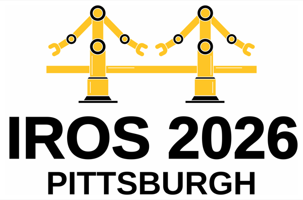
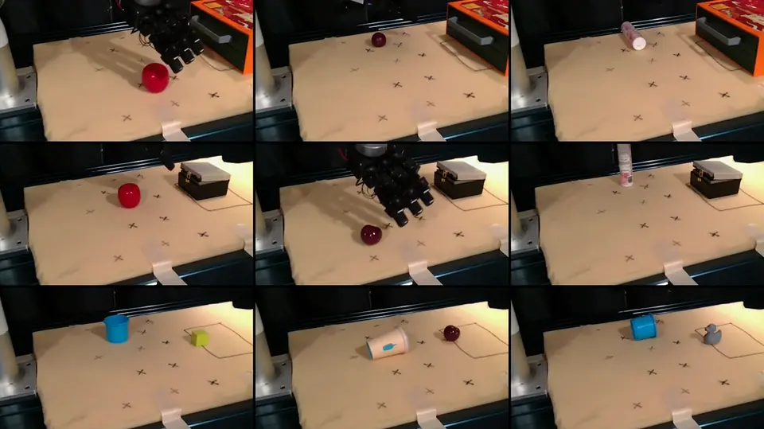
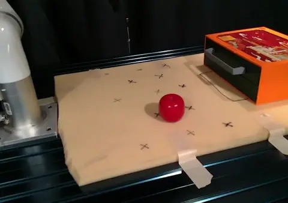
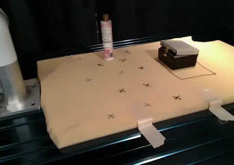
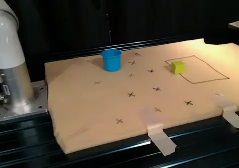
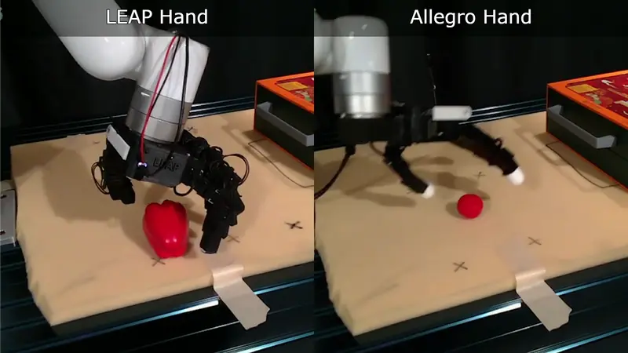
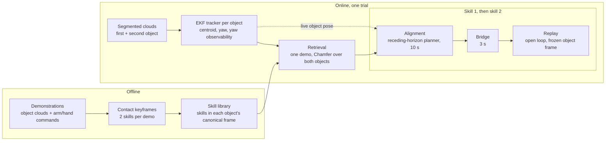
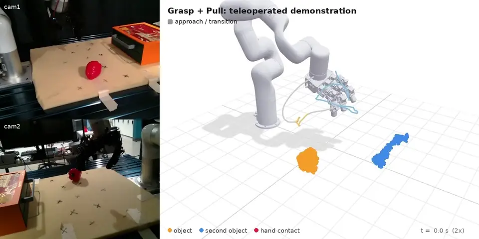

<div align="center">

# DexMulti

### Concurrent Prehensile and Nonprehensile Manipulation:<br>A Practical Approach to Multi-Stage Dexterous Tasks



**IROS 2026 · Pittsburgh, USA**

[Hao Jiang](https://haojiang4400.github.io), Yue Wu, Yue Wang, Gaurav S. Sukhatme, Daniel Seita

[](https://dexmulti.github.io/)
[](https://arxiv.org/abs/2603.11655)
[](https://huggingface.co/datasets?search=HJ666%2Fdexmulti)
[](LICENSE)



</div>

DexMulti does multi-stage tasks with a dexterous hand: it grasps a first object and then, **while still holding it**, pulls open a drawer, pushes open a container lid, or grasps a second object. It learns from a few dozen teleoperated demonstrations and **trains no policy**: each demonstration is split at contact keyframes into two object-centric skills, one demonstration is retrieved by comparing both objects' shapes, and its skills are aligned to the live object poses and replayed.

## 🎬 Results

<table>
  <tr>
    <td align="center" width="33%"><br><b>Grasp + Pull</b><br>hold an apple, pull open the drawer, place it inside</td>
    <td align="center" width="33%"><br><b>Grasp + Open</b><br>hold a lotion, push open the lid, place it inside</td>
    <td align="center" width="33%"><br><b>Grasp + Grasp</b><br>hold one object, grasp a second one</td>
  </tr>
</table>

<div align="center">
<br>
<b>Across embodiments:</b> LEAP Hand and Allegro Hand (paper, Table III). This release ships the LEAP Hand setup.
</div>

More videos on the [project page](https://dexmulti.github.io/).

## 🧠 How it works

**Offline**, each demonstration is cut at contact keyframes into two skills, stored in the canonical frame of the object each acts on. **Online**, an EKF tracks each object's position and yaw (and whether the yaw is observable), one demonstration is retrieved by Chamfer distance over both objects, and for each skill a collision-aware planner brings the arm and hand to the skill's first pose, a short bridge closes the gap, and the skill is replayed open loop.

<details>
<summary>Pipeline diagram</summary>



</details>

## 🛠️ Installation

```bash
git clone https://github.com/Msornerrrr/dexmulti.git && cd dexmulti
conda create -n dexmulti python=3.11 && conda activate dexmulti
pip install -e ".[lerobot,viz,data,dev]"   # quick start below
pip install -e ".[perception,planner]"     # optional: contact maps, alignment planner, deploy.py
```

<details>
<summary>Extras and notes</summary>

| Extra | Adds | Needed for |
|---|---|---|
| (core) | numpy, scipy | library, retrieval, tracker, execution (Python >= 3.10) |
| `perception` | open3d, scikit-learn | contact maps, point-cloud cleaning |
| `planner` | pyronot, jaxls, jax 0.8.1 | alignment planner, `deploy.py`. **Needs Python >= 3.11** |
| `lerobot` | pyarrow, huggingface_hub | reading the released datasets without `lerobot`/`torch` |
| `viz` | viser, av | `visualize_demo.py`, `retrieve_offline.py --viz` |
| `data` | huggingface_hub | `download_data.py` |
| `dev` | pytest | tests |

- Python 3.11 is the tested version for all extras. The `lerobot` package itself (only for `LeRobotDataset`, see [docs/dataset.md](docs/dataset.md)) needs Python >= 3.12; we used `lerobot==0.6.1` in a separate environment.
- The planner runs on CPU: JIT warmup about 18 s, then about 40 ms per step on a 32-core CPU. JAX prints "a CUDA-enabled jaxlib is not installed. Falling back to cpu", which is harmless. For a GPU, `pip install "jax[cuda12]==0.8.1"`.

</details>

## 🚀 Quick start (no robot)

```bash
python scripts/download_data.py --dataset grasp_pull                                  # -> data/lerobot/dexmulti_grasp_pull
python scripts/visualize_demo.py --dataset data/lerobot/dexmulti_grasp_pull --episode 0   # viser at http://localhost:8080
python scripts/lerobot_to_npz.py --dataset data/lerobot/dexmulti_grasp_pull --out data/npz/grasp_pull
python scripts/retrieve_offline.py --session data/npz/grasp_pull                       # leave-one-out retrieval (--viz to inspect)
pytest
```

<details>
<summary>Notes</summary>

- `download_data.py --no-videos` skips the camera videos; that is enough for conversion, retrieval and library building, but not for `visualize_demo.py`. `--dataset all` fetches all four datasets.
- On a remote machine, forward the viewer with `ssh -L 8080:localhost:8080 <host>`.
- `retrieve_offline.py` prints, per demonstration, the retrieved demo and the grasp-pose error against the human's grasp. Expected medians: 5.5 cm / 28.8° (`grasp_pull`), 5.9 cm / 35.8° (`grasp_open`), 5.2 cm / 36.6° (`grasp_grasp`). It checks retrieval and the tracker on recorded data; it does not reproduce a paper number.
- Sample-efficiency sets: `lerobot_to_npz.py --dataset data/lerobot/dexmulti_grasp_open_sample_efficiency --split quantity_5 --out data/npz/quantity_5`.
- Planner tests need the `planner` extra and one round-trip test needs `lerobot`; both are skipped otherwise.

</details>

## 📦 Dataset

<div align="center">

</div>

All teleoperated demonstrations used in the paper, in [LeRobot](https://github.com/huggingface/lerobot) v3.0 format: two RGB cameras, segmented object point clouds, hand point clouds and contact maps, arm and hand states and commands, skill labels, plus the keyframes and skill libraries used in the experiments.

| Dataset | Task | Demos |
|---|---|---|
| [`HJ666/dexmulti_grasp_pull`](https://huggingface.co/datasets/HJ666/dexmulti_grasp_pull) | Grasp + Pull | 38 |
| [`HJ666/dexmulti_grasp_open`](https://huggingface.co/datasets/HJ666/dexmulti_grasp_open) | Grasp + Open | 40 |
| [`HJ666/dexmulti_grasp_grasp`](https://huggingface.co/datasets/HJ666/dexmulti_grasp_grasp) | Grasp + Grasp | 36 |
| [`HJ666/dexmulti_grasp_open_sample_efficiency`](https://huggingface.co/datasets/HJ666/dexmulti_grasp_open_sample_efficiency) | Grasp + Open, 7 training sets | 124 |

Format, frames and loading options: [docs/dataset.md](docs/dataset.md).

## 🤖 On a robot

Implement `RobotInterface` and `Perception` ([dexmulti/interfaces.py](dexmulti/interfaces.py)), record demonstrations in the same format, then build keyframes and a library (`scripts/segment_keyframes.py`, `scripts/build_library.py`) and run a trial as in [scripts/deploy.py](scripts/deploy.py). [docs/adapting.md](docs/adapting.md) walks through it.

Our experiments used a UFACTORY xArm7 with a LEAP Hand, two Intel RealSense L515 cameras with Grounding DINO + SAM2 segmentation, and DexCap teleoperation, on ROS1 (Noetic); [robots/xarm_leap_ros1](robots/xarm_leap_ros1) connects DexMulti to this setup. The rest of the real-world pipeline (drivers, perception, teleoperation) is hardware dependent; we will release our full ROS system separately.

## 📖 Documentation

| Page | Read it for |
|---|---|
| [docs/design.md](docs/design.md) | Why each design choice was made, what it assumes, what to change |
| [docs/adapting.md](docs/adapting.md) | Porting to another robot, hand, sensor setup or task |
| [docs/dataset.md](docs/dataset.md) | The released demonstrations: features, frames, extras, splits |
| [docs/method.md](docs/method.md) | Paper sections and equations mapped to code |
| [docs/reproducing.md](docs/reproducing.md) | Data and settings behind each result, known differences |
| [baselines/object_centric_dp3](baselines/object_centric_dp3/README.md) | The object-centric DP3 baseline |

<details>
<summary>Repository layout</summary>

| Path | Contents |
|---|---|
| [dexmulti/](dexmulti) | Core library (numpy/scipy, no ROS): skill library, retrieval, runner, bridge and replay with safety limits, all defaults in `config.py`, robot and perception interfaces |
| [dexmulti/perception/](dexmulti/perception) | EKF object tracker with yaw observability, object collision spheres, hand contact maps, point-cloud cleaning |
| [dexmulti/alignment/](dexmulti/alignment) | Pyroki/pyronot receding-horizon planner, collision world, alignment targets |
| [dexmulti/data/](dexmulti/data) | Episode format, contact-based keyframes, reader for the LeRobot datasets |
| [scripts/](scripts) | `download_data`, `visualize_demo`, `lerobot_to_npz`, `segment_keyframes`, `build_library`, `retrieve_offline`, `deploy` |
| [robots/xarm_leap_ros1/](robots/xarm_leap_ros1) | ROS1 interface for the xArm7 + LEAP Hand setup used in the paper |
| [baselines/object_centric_dp3/](baselines/object_centric_dp3) | Object-centric DP3 baseline: converter, training, serving, client |
| [assets/xarm7_leap/](assets/xarm7_leap) | xArm7 + LEAP Hand URDF with collision spheres |
| [tests/](tests) | Unit and regression tests |

</details>

## 📝 Citation

```bibtex
@inproceedings{jiang2026concurrent,
  title     = {Concurrent Prehensile and Nonprehensile Manipulation: A Practical Approach to Multi-Stage Dexterous Tasks},
  author    = {Jiang, Hao and Wu, Yue and Wang, Yue and Sukhatme, Gaurav S. and Seita, Daniel},
  booktitle = {IEEE/RSJ International Conference on Intelligent Robots and Systems (IROS)},
  year      = {2026}
}
```

## 📄 License

Code: MIT ([LICENSE](LICENSE)). Dataset: CC-BY-4.0. Third-party code and assets (pyronot/PyRoki, foam, LEAP Hand model, xArm meshes, Improved-3D-Diffusion-Policy) keep their own licenses, listed in [NOTICE](NOTICE).
