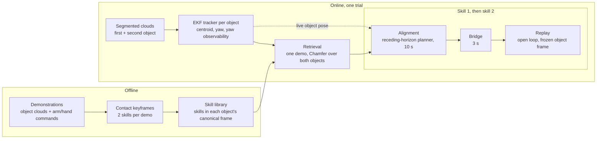

# DexMulti

**Concurrent Prehensile and Nonprehensile Manipulation: A Practical Approach to Multi-Stage Dexterous Tasks**
Hao Jiang, Yue Wu, Yue Wang, Gaurav S. Sukhatme, Daniel Seita. IROS 2026.

[Project page](https://dexmulti.github.io/) · [arXiv:2603.11655](https://arxiv.org/abs/2603.11655) · [Dataset](https://huggingface.co/datasets?search=HJ666%2Fdexmulti)

DexMulti does multi-stage tasks with a dexterous hand: it grasps a first object and then, while still holding it, pulls open a drawer, pushes open a container lid, or grasps a second object. It does this from a few dozen teleoperated demonstrations and **trains no policy**: offline, each demonstration is split at contact keyframes into two skills, stored in the canonical frame of the object they act on. Online, an EKF tracks each object's position and yaw (and whether the yaw is observable), and one demonstration is retrieved by comparing both object shapes in canonical space. For each skill, a collision-aware planner brings the arm and hand to the skill's first pose in the live object frame, a short bridge closes the remaining gap, and the rest of the skill is replayed open loop; holding the first object during skill 2 comes from the replayed hand trajectory.



## What is in this repository

| Path | Contents |
|---|---|
| [dexmulti/](dexmulti) | Core library (numpy/scipy, no ROS): [library.py](dexmulti/library.py) builds the skill library, [retrieval.py](dexmulti/retrieval.py) does the Chamfer retrieval, [runner.py](dexmulti/runner.py) runs a trial, [execution.py](dexmulti/execution.py) runs bridge and replay with safety limits, [config.py](dexmulti/config.py) holds every default, [interfaces.py](dexmulti/interfaces.py) defines what your robot and perception must provide |
| [dexmulti/perception/](dexmulti/perception) | EKF object tracker and yaw observability ([tracker.py](dexmulti/perception/tracker.py), [state.py](dexmulti/perception/state.py)), object collision spheres, hand contact maps, point-cloud cleaning (CPU) |
| [dexmulti/alignment/](dexmulti/alignment) | Pyroki/pyronot receding-horizon planner, collision world (ground and wall planes), alignment targets |
| [dexmulti/data/](dexmulti/data) | Episode format, contact-based keyframe segmentation, reader for the released LeRobot datasets |
| [scripts/](scripts) | `download_data`, `visualize_demo`, `lerobot_to_npz`, `segment_keyframes`, `build_library`, `retrieve_offline`, `deploy` |
| [robots/xarm_leap_ros1/](robots/xarm_leap_ros1) | ROS1 interface for the xArm7 + LEAP Hand setup used in the paper |
| [baselines/object_centric_dp3/](baselines/object_centric_dp3) | The object-centric DP3 baseline: data converter, training, serving, client |
| [assets/xarm7_leap/](assets/xarm7_leap) | xArm7 + LEAP Hand URDF with collision spheres, used by the planner |
| [tests/](tests) | Unit and regression tests |
| [docs/](docs) | Design rationale, adaptation guide, dataset, method-to-code map, reproduction notes |

## Install

```bash
git clone https://github.com/Msornerrrr/dexmulti.git dexmulti && cd dexmulti
conda create -n dexmulti python=3.11 && conda activate dexmulti
pip install -e ".[lerobot,viz,data,dev]"   # everything needed for the quick start below
pip install -e ".[perception,planner]"     # optional: contact maps, alignment planner, deploy.py
```

| Extra | Adds | Needed for |
|---|---|---|
| (core) | numpy, scipy | library, retrieval, tracker, execution (Python >= 3.10) |
| `perception` | open3d, scikit-learn | contact maps, point-cloud cleaning |
| `planner` | pyronot, jaxls, jax 0.8.1 (pinned to the versions used on the robot) | alignment planner, `deploy.py`. **Needs Python >= 3.11** |
| `lerobot` | pyarrow, huggingface_hub | reading the released datasets without `lerobot`/`torch` |
| `viz` | viser, av | `visualize_demo.py`, `retrieve_offline.py --viz` |
| `data` | huggingface_hub | `download_data.py` |
| `dev` | pytest | tests |

Python 3.11 is the tested version for all extras. The `lerobot` package itself (only for loading with `LeRobotDataset`, see [docs/dataset.md](docs/dataset.md)) is not an extra and needs Python >= 3.12; we used `pip install lerobot==0.6.1` in a separate 3.12 environment.

The planner runs on CPU. Every JAX import then prints "a CUDA-enabled jaxlib is not installed. Falling back to cpu", which is harmless. On a 32-core CPU the first call takes about 18 s (JIT warmup) and a planner step about 40 ms median, with occasional steps over the 100 ms control period. For a GPU, `pip install "jax[cuda12]==0.8.1"`.

## Quick start (no robot)

```bash
# 1. Download one task (lands in data/lerobot/dexmulti_grasp_pull/)
python scripts/download_data.py --dataset grasp_pull
# 2. Browse a demonstration in viser (http://localhost:8080): videos, point clouds, contact, skill phases
python scripts/visualize_demo.py --dataset data/lerobot/dexmulti_grasp_pull --episode 0
# 3. Convert to the npz session layout (episodes, keyframes and the shipped skill library)
python scripts/lerobot_to_npz.py --dataset data/lerobot/dexmulti_grasp_pull --out data/npz/grasp_pull
# 4. Leave-one-out retrieval: per demo, the retrieved demo and the grasp-pose error vs. the human's grasp
python scripts/retrieve_offline.py --session data/npz/grasp_pull          # add --viz to inspect each retrieval
# 5. Tests (planner tests need the [planner] extra; one LeRobot round-trip test needs the lerobot package;
#    both are skipped otherwise)
pytest
```

- `download_data.py --no-videos` skips the camera videos. That is enough for conversion, retrieval and library building, but `visualize_demo.py` needs the videos.
- `visualize_demo.py` serves until Ctrl+C (`--port` to change it). On a remote machine use `ssh -L 8080:localhost:8080 <host>`, or `--check N` for a headless smoke test that decodes N frames and exits. `retrieve_offline.py --viz` always serves on port 8080 and waits for Enter in the terminal before each episode.
- Expected output of step 4: one line per episode (retrieved demo, score, yaw observability, grasp-pose error) and a median summary. On the released data the medians are 5.5 cm / 28.8 deg (`grasp_pull`, 38 episodes), 5.9 cm / 35.8 deg (`grasp_open`, 40) and 5.2 cm / 36.6 deg (`grasp_grasp`, 36). Single episodes can reach 15-19 cm or over 90 deg: leave-one-out often retrieves a demo of a different object or grasp, and the rotation error says little for near-symmetric objects such as the apple. Medians close to these values mean the install works. `retrieve_offline.py` is a sanity check of retrieval and the tracker on recorded data, not a reproduction of a paper result.

`download_data.py` puts each dataset in `data/lerobot/dexmulti_<name>/`. Datasets: `grasp_pull` (38 demos), `grasp_open` (40), `grasp_grasp` (36) and `grasp_open_sample_efficiency` (124 recordings, 7 training sets). `download_data.py` always fetches the whole sample-efficiency dataset; select one training set in `lerobot_to_npz.py` or `visualize_demo.py` with `--split`:

```bash
python scripts/lerobot_to_npz.py --dataset data/lerobot/dexmulti_grasp_open_sample_efficiency --split quantity_5 --out data/npz/quantity_5
```

To use your own demonstrations: record episodes in the same format, run `scripts/segment_keyframes.py --session <dir>` (needs hand clouds and contact maps; see [docs/adapting.md §1](docs/adapting.md#1-record-demonstrations)) and `scripts/build_library.py --session <dir>`, then implement `RobotInterface` and `Perception` and run a trial as in [scripts/deploy.py](scripts/deploy.py). [docs/adapting.md](docs/adapting.md) walks through this.

## Documentation

| Page | Read it for |
|---|---|
| [docs/design.md](docs/design.md) | Why each design choice was made, what it assumes, what to change |
| [docs/adapting.md](docs/adapting.md) | Porting to another robot, hand, sensor setup or task |
| [docs/dataset.md](docs/dataset.md) | The released demonstrations: features, frames, extras, sample-efficiency splits |
| [docs/method.md](docs/method.md) | Paper sections and equations mapped to code |
| [docs/reproducing.md](docs/reproducing.md) | Data and settings behind each result, equivalence checks, known differences |
| [baselines/object_centric_dp3/README.md](baselines/object_centric_dp3/README.md) | The object-centric DP3 baseline |
| [robots/xarm_leap_ros1/README.md](robots/xarm_leap_ros1/README.md) | ROS1 interface for the paper's robot |

## Hardware

The experiments used a UFACTORY xArm7 with a LEAP Hand (16 DoF), two Intel RealSense L515 cameras with Grounding DINO + SAM2 segmentation, and DexCap teleoperation, on ROS1 (Noetic). [robots/xarm_leap_ros1](robots/xarm_leap_ros1) connects DexMulti to this setup (`python scripts/deploy.py --library <session>/library/dual_task_policy_chamfer.npz`). The rest of the real-world pipeline (drivers, perception, teleoperation) is hardware dependent; we will release our full ROS system separately.

## Citation

```bibtex
@inproceedings{jiang2026concurrent,
  title     = {Concurrent Prehensile and Nonprehensile Manipulation: A Practical Approach to Multi-Stage Dexterous Tasks},
  author    = {Jiang, Hao and Wu, Yue and Wang, Yue and Sukhatme, Gaurav S. and Seita, Daniel},
  booktitle = {IEEE/RSJ International Conference on Intelligent Robots and Systems (IROS)},
  year      = {2026}
}
```

## License

- Code: MIT, see [LICENSE](LICENSE).
- Dataset: CC-BY-4.0.
- Third-party code and assets (pyronot/PyRoki, foam, LEAP Hand model, xArm meshes, Improved-3D-Diffusion-Policy) keep their own licenses, listed in [NOTICE](NOTICE).
