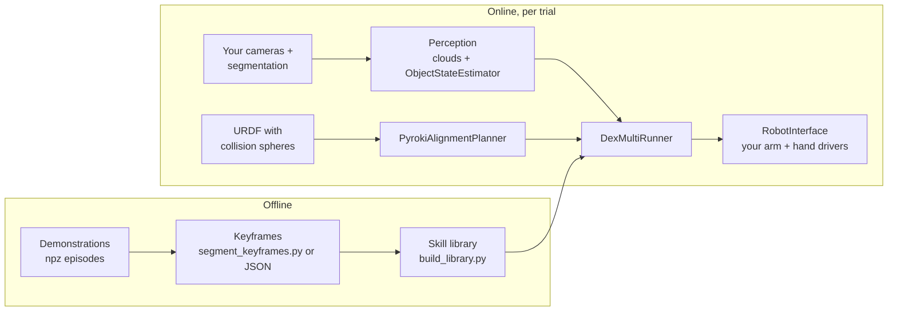

# Adapting DexMulti to your robot

This page is a practical guide to running DexMulti on a robot, hand or sensor setup other
than the paper's: xArm7 + LEAP Hand (16 DoF), two RealSense L515 cameras and a ROS1 stack.
It lists what you have to provide, which values depend on the setup, and how to test each
piece before running on hardware. For *why* each stage works the way it does, see
[design.md](design.md). For the data layout, see [dataset.md](dataset.md#npz-formats).

Terminology follows the code: the **first object** (code: `object`) is grasped in skill 1.
The **second object** (code: `drawer`) is the drawer, container lid or second object that
skill 2 acts on while the first object is still held.

## What you provide



Checklist:

- [ ] Demonstrations recorded on the same hand, mounted the same way, written as npz episodes ([§1](#1-record-demonstrations))
- [ ] Skill keyframes for every episode ([§2](#2-keyframes))
- [ ] A skill library whose offline leave-one-out retrieval looks like the released data's: similar median errors, no systematic offset ([§3](#3-build-and-inspect-the-library-offline))
- [ ] A `Perception` implementation: segmented clouds plus one `ObjectStateEstimator` per object at about 30 Hz ([§4](#4-perception-online))
- [ ] A `RobotInterface` implementation: non-blocking 10 Hz streaming in joint and pose mode ([§5](#5-robot-interface))
- [ ] A URDF of arm + hand with collision spheres, and the planner warmed up before the trial ([§6](#6-planner))
- [ ] Setup-specific values in `DexMultiConfig` and a few module constants ([§7](#7-setup-specific-values))
- [ ] The testing ladder, ending with slow hardware runs ([§8](#8-testing-ladder))

Install what you need:

```bash
pip install -e ".[perception,planner,dev]"   # planner pins jax 0.8.1, needs Python >= 3.11
pip install -e ".[viz]"                      # optional: viser viewer for retrieve_offline.py --viz
```

## 1. Record demonstrations

Each demonstration performs the whole task (grasp the first object, then act on the second
object while holding it). Record one npz file per demonstration, at the rate you will
replay it (10 Hz, `DeployConfig.ctrl_hz`). Everything is in one fixed frame, the arm base.
The base z axis must point up, because the canonical frame only removes the object's
position and its yaw about z.

| key (constant in [dexmulti/config.py](../dexmulti/config.py)) | shape | needed by |
|---|---|---|
| `arm_cmd` | (T, 6) | library (falls back to `eef_pose` if missing), `retrieve_offline.py` |
| `hand_cmd` | (T, H) | library (`save_library` refuses a library without hand commands) |
| `fused_segmented_point_cloud_base_object` (`OBJ_PC_KEY`) | (T, N, 3) | library, `retrieve_offline.py` |
| `fused_segmented_point_cloud_base_drawer` (`DRAWER_PC_KEY`) | (T, N, 3) | library, `retrieve_offline.py` |
| `hand_point_cloud_base` (`HAND_PC_KEY`) | (T, M, 3) | automatic keyframes only |
| `OBJ_CONTACT_KEY`, `DRAWER_CONTACT_KEY` | (T, N) | automatic keyframes only |
| `time`, `eef_pose`, `arm_state`, `hand_state` | | optional; `eef_pose` is the library's fallback for `arm_cmd`; `arm_state`/`hand_state` feed the hand-cloud FK below |

Notes on each entry:

- **Commanded, not measured.** The library replays `arm_cmd` and `hand_cmd`. For the hand
  this matters: during a grasp, the measured joints stop at the object surface, while the
  commanded joints keep squeezing past it. That difference is what makes the PD controller
  apply grip force. Replaying measured joints would loosen the grasp.
- **Poses** are `[x, y, z, roll, pitch, yaw]` in meters and radians, with scipy Euler
  `"xyz"`, i.e. `Rotation.from_euler("xyz", rpy)`. The pose is that of the link your
  controller commands, which is also the planner's `target_link_name` (xArm `link7` here).
  If your driver uses quaternions or another Euler order, convert when recording and in your
  `RobotInterface`.
- **Hand joints** are stored and replayed verbatim, in your driver's joint order. The
  library holds EE poses relative to the object and raw hand commands. The arm itself does
  not appear in it, so in principle the demonstrations could drive a different arm carrying
  the same hand with the same EE-to-hand transform, as long as the poses are reachable. We
  have not tested this.
- **Object clouds**: one segmented cloud per object per frame, with a fixed N within an
  episode (the paper uses 512). Retrieval compares the live cloud with the library clouds
  by Chamfer distance, and both are partial views. Use the **same cameras, placement and
  cleaning chain** for recording and deployment, or the distances stop being meaningful.

### Producing object clouds

[dexmulti/perception/denoise.py](../dexmulti/perception/denoise.py) is a CPU reference of
the chain used in the paper: masked depth back-projection, transform to the base frame,
workspace crop, random downsampling, statistical and radius outlier removal per camera,
then DBSCAN and farthest-point sampling to 512 points on the fused cloud. The masks come
from your segmenter; the paper used Grounding DINO + SAM2. `SEGMENTED` holds the settings
used for the paper's object clouds. Its crop box is in the base frame and is setup specific:

```python
from dataclasses import replace
from dexmulti.perception.denoise import SEGMENTED, clean_single_view, fuse_views

cfg = replace(SEGMENTED, crop={"x": (0.2, 1.0), "y": (-0.4, 0.4), "z": (0.0, 0.7)})  # your workspace
views = [clean_single_view(depth, mask, (fx, fy, cx, cy), T_base_cam, cfg)  # depth in mm (depth_scale=0.001)
         for depth, mask, (fx, fy, cx, cy), T_base_cam in cameras]
cloud = fuse_views(views, cfg)   # (512, 3) in the base frame, or None if nothing survived
```

`T_base_cam` maps the camera optical frame (OpenCV convention) to the base frame. The CPU
chain is slower than the GPU version that ran on the robot at about 20 Hz. It is fine for
offline processing, but measure it before using it online.

### Hand cloud and contact maps (only for automatic keyframes)

The hand cloud is the hand's surface in the base frame at each frame, computed from the
joint states by forward kinematics. The code that produced the released hand clouds is not
part of this repository. The sketch below samples the hand-link visual meshes of the URDF
once and moves them with FK (requires the `[planner]` extra for `yourdfpy`/`trimesh`).
Applied to released Grasp + Pull episodes, its keyframes matched the released ones to
within 2 frames on the three episodes we checked:

```python
from pathlib import Path
import numpy as np, trimesh, yourdfpy
from dexmulti.perception.denoise import farthest_point_sample

URDF = Path("assets/xarm7_leap/xarm7_leap_right_spheres.urdf")
urdf = yourdfpy.URDF.load(str(URDF))
hand_links = ["palm_link"] + [l for l in urdf.link_map if l.startswith(("mcp_joint", "pip", "dip", "fingertip", "thumb"))]
local = {}                                    # link -> surface samples in the link frame
for name in hand_links:
    pts = []
    for v in urdf.link_map[name].visuals:
        if v.geometry.mesh is None:
            continue
        p, _ = trimesh.sample.sample_surface(trimesh.load(URDF.parent / v.geometry.mesh.filename, force="mesh"), 400, seed=0)
        T = v.origin if v.origin is not None else np.eye(4)
        pts.append(p @ T[:3, :3].T + T[:3, 3])
    if pts:
        local[name] = np.concatenate(pts)

def hand_cloud(arm_q, hand_q, n=512):
    urdf.update_cfg(np.concatenate([arm_q, hand_q]))   # URDF actuated-joint order
    pts = []
    for name, p in local.items():
        T = urdf.get_transform(name, "link_base")
        pts.append(p @ T[:3, :3].T + T[:3, 3])
    return farthest_point_sample(np.concatenate(pts).astype(np.float32), n)
```

Contact maps come from
[dexmulti/perception/contact.py](../dexmulti/perception/contact.py) (needs `open3d`).
On the released data it reproduces the released contact maps exactly:

```python
from dexmulti.perception.contact import contact_map_sequence
obj_contact, _ = contact_map_sequence(obj_clouds, hand_clouds)      # (T, N), (T, N, 4)
drawer_contact, _ = contact_map_sequence(drawer_clouds, hand_clouds)
```

### Writing an episode

```python
from pathlib import Path
import numpy as np
from dexmulti.config import DRAWER_CONTACT_KEY, DRAWER_PC_KEY, HAND_PC_KEY, OBJ_CONTACT_KEY, OBJ_PC_KEY

Path("data/npz/my_task").mkdir(parents=True, exist_ok=True)
np.savez(f"data/npz/my_task/{episode_name}.npz",
         arm_cmd=arm_cmd, hand_cmd=hand_cmd,                  # (T, 6), (T, H)
         **{OBJ_PC_KEY: obj_clouds, DRAWER_PC_KEY: drawer_clouds,
            # only for scripts/segment_keyframes.py:
            HAND_PC_KEY: hand_clouds, OBJ_CONTACT_KEY: obj_contact, DRAWER_CONTACT_KEY: drawer_contact})
```

A session is a folder of such files. The scripts take the folder as `--session`. The paper
used about 40 demonstrations per task, 3–4 per training object, starting from randomized
object placements.

## 2. Keyframes

Each episode needs `keyframes/<episode>.json` with four inclusive frame indices:
`task1_start`, `task1_end`, `task2_start`, `task2_end`. Skill k is replayed from
`task{k}_start` to `task{k}_end`. Everything else is discarded: the approach to the first
object and the transport to the second object are replaced by the planner's alignment.
The start frame of each skill is therefore the pose the planner must reach without
collision, at or just before first contact.

**Automatically**, from contact. Skill k starts at the first frame of the longest run of
sustained hand contact with object k. Skill 1 ends once the first object has been lifted,
and skill 2 runs to the end of the episode:

```bash
python scripts/segment_keyframes.py --session data/npz/my_task              # keeps existing files
python scripts/segment_keyframes.py --session data/npz/my_task --overwrite --contact-thr 0.8
```

Only the contact threshold is exposed on the command line. The other thresholds
(`KeyframeConfig` in [dexmulti/data/keyframes.py](../dexmulti/data/keyframes.py)) are in
meters and were set for the paper's objects: lift height between 2 and 3.5 cm, and a hand
distance threshold between 3 and 15 cm that scales with object size. Check them for much
smaller or larger objects.

**By hand**, when you have no hand cloud or the automatic result is wrong:

```json
{"task1_start": 44, "task1_end": 85, "task2_start": 99, "task2_end": 210}
```

Always look at a few segmented episodes. A skill start detected too late cuts off the grasp
approach. One detected too early makes the planner aim for a pose far from the object.
No viewer for npz episodes or keyframes is shipped (`retrieve_offline.py --viz` shows only
the retrieved trajectory, and `visualize_demo.py` reads LeRobot datasets). A quick check is
to plot the per-frame maximum contact and the commanded EE height with the four keyframes
marked (needs `matplotlib`, which is not a dependency):

```python
import json
from pathlib import Path

import matplotlib.pyplot as plt
import numpy as np
from dexmulti.config import DRAWER_CONTACT_KEY, OBJ_CONTACT_KEY

session, ep = Path("data/npz/my_task"), "episode_000"
d = np.load(session / f"{ep}.npz")
kf = json.loads((session / "keyframes" / f"{ep}.json").read_text())
fig, (a0, a1) = plt.subplots(2, 1, sharex=True)
a0.plot(d[OBJ_CONTACT_KEY].max(axis=1), label="first object")
a0.plot(d[DRAWER_CONTACT_KEY].max(axis=1), label="second object")
a0.set_ylabel("max contact"); a0.legend()
a1.plot(d["arm_cmd"][:, 2]); a1.set_ylabel("commanded EE z [m]"); a1.set_xlabel("frame")
for name in ("task1_start", "task1_end", "task2_start", "task2_end"):
    for a in (a0, a1):
        a.axvline(kf[name], ls="--", c="k")
fig.savefig(f"{ep}_keyframes.png")
```

Skill 1 should start where contact with the first object rises and end once the EE has
lifted the object by a few centimeters. Skill 2 should start where contact with the second object rises.

## 3. Build and inspect the library offline

```bash
python scripts/build_library.py --session data/npz/my_task
# -> data/npz/my_task/library/dual_task_policy_chamfer.npz
python scripts/retrieve_offline.py --session data/npz/my_task           # needs >= 2 demos
python scripts/retrieve_offline.py --session data/npz/my_task --viz     # needs the [viz] extra
```

`retrieve_offline.py` holds out each demonstration in turn and runs the object state
estimator on its first frames. It then retrieves a demonstration from the remaining ones and
maps that demonstration's first grasp pose into the held-out scene. It reports the distance
to the pose the demonstrator actually used. It loads `<session>/library/dual_task_policy_chamfer.npz`
if that file exists and builds a library in memory only if it does not, so rerun
`build_library.py` after changing keyframes (or pass `--library`).

For reference, the released sessions give these medians:

| session | episodes | median grasp pose error |
|---|---|---|
| Grasp + Pull | 38 | 5.5 cm / 28.8° |
| Grasp + Open | 40 | 5.9 cm / 35.8° |
| Grasp + Grasp | 36 | 5.2 cm / 36.6° |

Some single episodes with errors of 15 cm or more, or above 90°, are normal. Leaving one out can
retrieve a demonstration of a different object or a different grasp, and for near-symmetric
objects such as the apple the rotation error says little. A setup is fine when its medians are
close to these values and `--viz` shows no systematic offset between the mapped trajectory and
the scene. Medians well above these, or the same offset on every episode, usually mean
inconsistent frames (pose convention, EE link, camera extrinsics) or keyframes at the wrong
place. With `--viz`, each scene is shown in viser with the retrieved, mapped skill trajectory
and the demonstrator's grasp frame.

Both scripts work on any npz session that has only the four required keys (verified).
[scripts/visualize_demo.py](../scripts/visualize_demo.py) reads LeRobot datasets only. It
does not open npz sessions.

## 4. Perception online

Implement `Perception` from [dexmulti/interfaces.py](../dexmulti/interfaces.py) for
`name in ("object", "drawer")`:

| method | returns |
|---|---|
| `get_cloud(name)` | latest segmented, fused cloud (N, 3) in the base frame, same pipeline as the demonstrations |
| `get_state(name)` | latest `ObjectState` (center, task yaw, yaw observability, collision spheres), or `None` before the first one |

The simplest `get_state` feeds every new cloud to one
[`ObjectStateEstimator`](../dexmulti/perception/state.py) per object, in a loop at
`TrackerConfig.rate_hz` (30 Hz). This loop runs on its own thread or node, and it keeps
updating during the trial. `RosPerception` in
[robots/xarm_leap_ros1/adapter.py](../robots/xarm_leap_ros1/adapter.py) is an example:
subscriber callbacks store the clouds, a 30 Hz timer updates the estimators, and a lock
protects the latest clouds and states.

```python
from dexmulti.config import TrackerConfig
from dexmulti.perception import ObjectStateEstimator

est = ObjectStateEstimator(TrackerConfig())    # one per object
state = est.update(cloud)                      # call at ~30 Hz; returns the latest ObjectState (or None)
```

Requirements and pitfalls:

- **Readiness.** `run_once` raises if either state is `None`. A state exists after the first
  update, but the yaw-observability belief starts at 0.5 and moves with an EMA of 0.03 per
  update. Even for a clearly elongated object it needs about 17 belief updates (≈0.6 s at
  30 Hz) to cross the 0.7 "observable" threshold; the very first `update()` only initialises
  the filter. The demonstration is retrieved once, at the start, using the first object's
  flag. Before skill 2, the second object's flag and cloud are read again to re-estimate its
  yaw offset, so its estimator and segmentation must stay valid through skill 1. Let the
  estimators run for a few seconds on the static scene first. `retrieve_offline.py` uses
  3 s. On the robot, the planner warmup and the move to the start pose took longer than
  that.
- **Rate.** The EKF noise and the belief EMA are tuned per update, with the EKF step fixed
  at `ekf_dt = 0.01` s, a value kept as it ran. Keep the estimator at about 30 Hz. If you
  feed clouds from a ~20 Hz camera pipeline, the 30 Hz loop simply re-uses the latest
  cloud, as on the robot.
- **Never go back to `None`.** Once a state exists, keep returning the last one; an empty
  cloud leaves `ObjectStateEstimator.state` unchanged. A missing state during alignment
  shrinks the collision world, which triggers a planner recompile (see §6).
- **Point counts.** The collision envelope splits the cloud into `num_spheres = 6` bins.
  A bin with fewer than 40 points is skipped (`MultiSphereEnvelope.min_points_per_bin`),
  and a sphere that never got a radius is dropped from the world. With 512-point clouds
  this does not happen.
- **Yaw observability** depends on metric thresholds in `ObjectFrameTracker`
  ([tracker.py](../dexmulti/perception/tracker.py)): `yaw_aniso_ref = 2.0` (XY principal
  axis ratio), `xy_extent_ref = 0.025` m (XY standard deviation along the principal axis),
  `yaw_std_ref = 5°`, `obs_on/obs_off = 0.7/0.3`. They are plain attributes, so you can set
  them per object (`est.tracker.xy_extent_ref = ...`) if your objects are much smaller or
  larger than the paper's. See [design.md](design.md#23-state-estimation).
- **Segmentation leaking onto the hand** moves the centroid. The first object's state is
  used only for skill 1. The second object's state is used during skill-2 alignment, when the
  hand holds the first object close to it.

## 5. Robot interface

Implement `RobotInterface` from [dexmulti/interfaces.py](../dexmulti/interfaces.py).
`DexMultiRunner` calls it from one thread at `DeployConfig.ctrl_hz` (10 Hz):

| method | used in | contract |
|---|---|---|
| `get_eef_pose()` | bridge (start pose); bridge and replay (`clip_and_clamp`) | (6,) measured pose of the commanded EE link, base frame, scipy `"xyz"` |
| `get_arm_joints()` | alignment | (7,) arm joints, in the URDF's actuated order |
| `get_hand_joints()` | alignment, bridge | (H,) hand joints, in the URDF's and the demonstrations' order |
| `set_control_mode("joint")` | start of each skill | next commands are streamed joint targets |
| `set_control_mode("pose")` | after alignment | next commands are streamed Cartesian targets |
| `send_arm_joints(q)` | alignment | (7,) target, the planner's configuration one `dt` = 0.1 s ahead |
| `send_eef_pose(pos, rpy)` | bridge, replay | Cartesian target, already clipped and rate-limited |
| `send_hand(q)` | all phases | (H,) hand target |

- **Non-blocking.** Every `send_*` must return immediately. The loops use a fixed-rate
  timer (`execution.Rate`) that re-anchors on overrun, so blocking calls stretch the replay
  in time. Make the arm move to each target within roughly one control period. On the xArm
  this was the driver's online trajectory planning: mode 6 for joints and mode 7 for
  Cartesian targets, with velocity caps in the adapter.
- **Hand upsampling** is the adapter's job. The ROS1 adapter interpolates the 10 Hz
  hand targets linearly to the LEAP PD rate (40 Hz).
- **Safety in pose mode.** Every Cartesian command the runner sends (bridge and replay)
  passes through `execution.clip_and_clamp`. It clips to `ArmLimits.workspace`, then limits the step from
  the *measured* pose to `max_step_pos_m = 0.01` m and `max_step_rot_deg = 2.5°`, i.e.
  0.1 m/s and 25°/s at 10 Hz. Because the step is measured from the current pose, a slow arm
  slows the motion down instead of building up an error. The hand is not limited.
- **Safety in joint mode.** Alignment commands bypass `clip_and_clamp`. They are bounded by
  the planner (URDF joint and velocity limits, collision costs) and by your driver's joint
  speed limits. Keep conservative velocity limits in the URDF and in the driver.
- **Start pose.** The runner does not move to a start pose. `scripts/deploy.py`
  (`move_to_start`) streams `DeployConfig.start_pos/start_rpy/start_hand` for 3 s before the
  trial, so the cameras see both objects unoccluded at retrieval. Do the same with your own
  values. `move_to_start` is **not** clamped: it streams the start pose at 20 Hz straight to
  `send_eef_pose`, with no workspace clip and no step limit (as in the experiments), and
  relies on the driver's trajectory planning. On a new setup, move the arm near the start
  pose first, or route the start move through `clip_and_clamp`.
- **Stopping.** Pass `early_stop_fn` (e.g. an e-stop or keyboard flag) to `DexMultiRunner`.
  It is checked at every control step. A driver error should raise; the ROS1 adapter
  raises on any non-zero return code.

## 6. Planner

[`PyrokiAlignmentPlanner`](../dexmulti/alignment/pyroki_planner.py) solves a short
trajectory optimization over arm + hand at every alignment step: 5 knots, `dt = 0.1` s,
warm-started from the previous solution. It tracks the target EE pose and hand target, with
joint and velocity limits, self-collision, and collision with the world (two planes plus
spheres for each object).

- **URDF with collision spheres.** Arm and hand in one URDF, with the hand attached to the
  flange by a fixed joint. Collision geometry is given as `<sphere>` elements, which
  [foam](https://github.com/CoMMALab/foam) can generate; see
  `assets/xarm7_leap/xarm7_leap_right_spheres.urdf`. Check the joint order with
  `planner.robot.joints.actuated_names`: the arm joints must come first, then the hand in
  the same order as `get_hand_joints()` and the recorded `hand_cmd`.
- **`target_link_name`** is the link whose pose is in `eef_pose`/`arm_cmd` (default
  `"link7"`).
- **Velocity limits** come from the URDF. The `rest` cost pulls toward the middle of the
  joint ranges (`joint_var_cls.default_factory()`), with a small weight.
- **Warmup and fixed world size.** The solver is JIT-compiled for a given number of
  collision primitives. Compilation takes about 18 s on CPU; without a warmup it would
  happen inside the 10 s alignment window. The run-time world is always 2 planes plus
  K spheres for the first object and K for the second (`build_world`). During skill 2 the
  held object's spheres are replaced by far-away placeholders, which keeps the count fixed.
  Warm up with a world built from the live states, as in the snippet below. If you add
  planes in `alignment/world.py:static_world`, the warmup picks them up automatically.
- **Cost presets.** `PlannerWeights.jan2026()` (default) and `dec2025()` differ in velocity
  limit, rest and collision-margin weights; see [reproducing.md](reproducing.md). Other
  weights are fixed inside `_solve_online_planning_jax`.
- **Timing.** One `planner.step` must finish well within `1/ctrl_hz`. Time it on your
  machine after the warmup. For reference, on a 32-core CPU with the default URDF and
  the full collision world: warmup about 16-18 s, step median 30-50 ms (`dec2025` is the
  faster preset); the 95th percentile per trial was usually under 100 ms but reached 250 ms
  once in 24 trials. A CUDA build of JAX (`pip install "jax[cuda12]==0.8.1"`, matching the
  pinned version) works but does not help: on an RTX PRO 6000 (Blackwell) the warmup took
  about 100 s and steps 49 ms median (95th percentile 250 ms), against 19 s and 41 ms (53 ms)
  on the CPU of the same machine. The problem is too small for the GPU; keep the planner on CPU.
  On a machine with an NVIDIA GPU but CPU-only jaxlib, every JAX import prints "An NVIDIA
  GPU may be present on this machine, but a CUDA-enabled jaxlib is not installed. Falling
  back to cpu." This is harmless.

Hard-coded for a 7-DoF arm and a 16-DoF hand. Change these for another embodiment:

| assumption | where |
|---|---|
| 7 arm joints first | `ARM_DOF` in [pyroki_planner.py](../dexmulti/alignment/pyroki_planner.py) (module level and inside `_solve_online_planning_jax`); `q_cmd[:7]` / `q_cmd[7:]` in `DexMultiRunner.align` ([runner.py](../dexmulti/runner.py)) |
| 16 hand joints | `HAND_DOF` inside `_solve_online_planning_jax` |
| open hand = all zeros | `open_hand` in `DexMultiRunner.align` (the planner's hand target during the first 75 % of grasp alignment; a soft cost, so the commanded hand can differ) |
| hand facing forward = EE yaw 0 | `resolve_yaw_sign_by_world_action` in [geometry.py](../dexmulti/geometry.py) resolves the PCA yaw ambiguity by choosing the commanded world EE yaw closest to 0, within `max_abs_world_yaw_rad`. If your demonstrations' typical approach does not correspond to a commanded EE yaw near 0 (different EE frame or robot placement), change the reference there |

### Putting it together

This is the same sequence as [scripts/deploy.py](../scripts/deploy.py). We ran it unchanged
against a fake robot and fake perception: it compiled the planner, retrieved a
demonstration and completed both skills.

```python
import time

from dexmulti import DexMultiConfig, DualTaskPolicyChamfer
from dexmulti.alignment.pyroki_planner import PlannerWeights, PyrokiAlignmentPlanner
from dexmulti.alignment.world import build_world
from dexmulti.runner import DexMultiRunner

cfg = DexMultiConfig()                          # edit setup-specific fields (section 7)
robot = MyRobot()                               # your RobotInterface
perception = MyPerception(cfg.tracker)          # your Perception (estimators running at ~30 Hz)
planner = PyrokiAlignmentPlanner(urdf_path="assets/my_robot/my_robot_spheres.urdf",
                                 target_link_name="link7", weights=PlannerWeights.jan2026())
policy = DualTaskPolicyChamfer("data/npz/my_task/library/dual_task_policy_chamfer.npz",
                               num_yaw_bins=cfg.retrieval.num_yaw_bins)

# 1. Wait for both object states, then let the estimators settle on the static scene.
while perception.get_state("object") is None or perception.get_state("drawer") is None:
    time.sleep(0.05)
time.sleep(3.0)

# 2. Compile the planner for the run-time world size (2 planes + K spheres per object).
obj, dr = perception.get_state("object"), perception.get_state("drawer")
planner.warmup(build_world(obj.sphere_centers, obj.sphere_radii, dr.sphere_centers, dr.sphere_radii,
                           exclude_object=False, cfg=cfg.world))

# 3. Move to your start pose (see section 5), then run one trial.
runner = DexMultiRunner(robot, perception, policy, planner, cfg, early_stop_fn=lambda: False)
ok = runner.run_once()
```

`num_yaw_bins` is not read from the config by `DualTaskPolicyChamfer`; pass it explicitly
as above. `run_once` returns `False` if a skill was stopped or alignment never got a state.

## 7. Setup-specific values

`DexMultiConfig` ([dexmulti/config.py](../dexmulti/config.py)) fields that depend on your
setup. Defaults are the paper's values, in the arm base frame:

| field | default | what it is / when to change |
|---|---|---|
| `arm.workspace` | x 0.1–0.7, y −0.5–0.5, z 0.15–0.5 m | box that every Cartesian command the runner sends (bridge, replay) is clipped to; `deploy.py`'s `move_to_start` and joint-mode alignment are not clipped; your reachable, collision-free table region |
| `arm.max_step_pos_m` | 0.01 m per step | 0.1 m/s at 10 Hz; per control step, so rescale if you change `ctrl_hz` |
| `arm.max_step_rot_deg` | 2.5° per step | 25°/s at 10 Hz; same remark |
| `world.ground_z` | 0.03 m | table plane height in the planner world |
| `world.wall_x` | 0.68 m | plane with normal −x behind the workspace; move it, or edit `static_world` for other static obstacles |
| `tracker.rate_hz` | 30 Hz | estimator loop rate; keep it (see §4) |
| `tracker.ekf_dt` | 0.01 s | kept as run; the EKF noise was tuned with it |
| `tracker.num_spheres` | 6 | collision spheres per object; changes the planner world size |
| `tracker.sphere_ema_alpha` | 0.1 | smoothing of the sphere envelope |
| `retrieval.lambda_drawer` | 0.3 | weight of the second object in the joint retrieval score |
| `retrieval.num_yaw_bins` | 24 | yaw hypotheses when yaw is unobservable (pass to `DualTaskPolicyChamfer`) |
| `retrieval.max_points` | 6000 | random downsampling of query clouds; above 512, so it has no effect on 512-point clouds |
| `retrieval.min_points` | 10 | not read by the code (the 10-point minimum is hard-coded in `retrieval.py`) |
| `deploy.ctrl_hz` | 10 Hz | command and replay rate; must equal the recording rate, since each recorded step is replayed as one tick. Keep `PyrokiAlignmentPlanner(dt=...)` at `1/ctrl_hz` |
| `deploy.align_seconds` | 10 s | fixed alignment window (no convergence test) |
| `deploy.bridge_seconds` | 3 s | interpolation to the skill's first pose; with the 0.1 m/s clamp it covers at most 0.3 m |
| `deploy.grasp_open_fraction` | 0.75 | share of the grasp-alignment window with the hand open |
| `deploy.max_abs_world_yaw_rad` | 120° | yaw-sign rule bound (see §6) |
| `deploy.start_pos`, `deploy.start_rpy` | (0.35, 0, 0.45), (3.14, 0, 0) | start pose used by `deploy.py`; pick one that leaves both objects visible |
| `deploy.start_hand` | 16 LEAP values | start hand configuration, in your hand's joint order |

Setup-specific values outside `DexMultiConfig`:

| value | where |
|---|---|
| cloud cleaning: crop box, outlier and DBSCAN parameters | `CleanConfig` / `SEGMENTED` in [perception/denoise.py](../dexmulti/perception/denoise.py) |
| yaw-observability thresholds | `ObjectFrameTracker.__init__` in [perception/tracker.py](../dexmulti/perception/tracker.py) |
| envelope minimum points per bin (40) | `MultiSphereEnvelope` in [perception/envelope.py](../dexmulti/perception/envelope.py) |
| keyframe lift / distance thresholds | `KeyframeConfig` in [data/keyframes.py](../dexmulti/data/keyframes.py) |
| URDF, EE link, horizon, `dt`, cost preset | `PyrokiAlignmentPlanner(...)` in [alignment/pyroki_planner.py](../dexmulti/alignment/pyroki_planner.py) |
| arm/hand DoF, open hand, yaw-sign reference | see the table in §6 |
| driver velocity caps, hand PD rate, topics | your adapter (reference: [robots/xarm_leap_ros1/adapter.py](../robots/xarm_leap_ros1/adapter.py)) |

## 8. Testing ladder

Go up one step at a time; each step isolates one source of failure.

1. **Unit and regression tests.** `pytest`. The planner tests skip without the `[planner]`
   extra, and the LeRobot tests need `pyarrow` (the `[lerobot]` extra). The `LeRobotDataset`
   test also needs the `lerobot` package itself, which no extra installs, so with all extras
   expect "24 passed, 1 skipped".
2. **Offline data checks** (§3): keyframes, `build_library.py`, `retrieve_offline.py`
   (`--viz`) on your session. Fix frames and keyframes here, not on the robot.
3. **Perception only, on the real setup.** Run your `Perception` and print the states for
   each object at rest. Then move and rotate the objects by hand. The centers should follow,
   elongated objects should become yaw-observable, and round ones should not.
4. **Planner only.** Load your URDF, check `planner.robot.joints.actuated_names`, warm up
   and time `planner.step(q, pos, rpy, hand_target, world)` for targets in your workspace
   ([tests/test_planner.py](../tests/test_planner.py) shows the calls).
5. **Simulated runner.** [tests/test_runner.py](../tests/test_runner.py) runs `run_once`
   end to end with a `SimRobot` that tracks commands perfectly, a `SimPerception` built from
   clouds, and a `HoldPlanner` stub (no JAX). Copy it, put in your library and clouds from
   one of your episodes, and check the final command against the mapped skill. Then swap in
   the real planner. To keep `get_eef_pose` consistent in joint mode, compute it from the
   joints by FK (`planner.robot.forward_kinematics`).
6. **Hardware, slowly.** Start with smaller `arm.max_step_pos_m` / `max_step_rot_deg` and
   conservative driver joint speeds, with `early_stop_fn` wired to a stop button. Place the
   objects as in one demonstration first: retrieval should pick that demonstration, and the
   alignment target should land on its grasp. Then randomize placements. With slower limits
   the replay lags behind the recorded motion and may cut corners, so return to the default
   limits once the frames are verified.

## 9. ROS1 adapter

[robots/xarm_leap_ros1](../robots/xarm_leap_ros1) is the ROS1 adapter for the paper's
setup: `XArmLeapRobot` (xarm_ros driver, mode 6/7 streaming, 10 → 40 Hz LEAP upsampling)
and `RosPerception` (segmented cloud topics plus one `ObjectStateEstimator` per object at
30 Hz). [scripts/deploy.py](../scripts/deploy.py) wires it up as in §6, with
`--planner-weights` and `--baseline-tracker` options. See its
[README](../robots/xarm_leap_ros1/README.md) for the environment
(conda ROS1 Noetic with Python 3.11 for the in-process planner).
