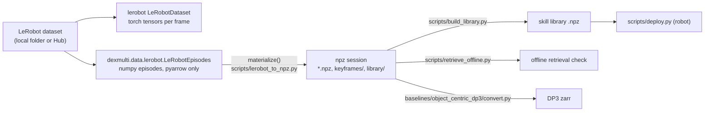

# Dataset

The demonstrations behind the paper are released as four [LeRobot](https://github.com/huggingface/lerobot)
v3.0 datasets: one per task, plus the Grasp + Open recordings of the sample-efficiency
experiments. Each dataset has the usual LeRobot content (parquet frames, two H.264 camera
videos, metadata) and a `dexmulti/` folder with the files the DexMulti code needs on top of
that: skill keyframes, the skill libraries that ran on the robot, and camera calibration.

Not included: depth images, segmentation masks, raw full-scene point clouds and trained
checkpoints. The point clouds in the data are the processed,
segmented object clouds that DexMulti consumes.


## Datasets

| dataset | task | episodes | frames | length (frames) | size (without videos) |
|---|---|---|---|---|---|
| [`HJ666/dexmulti_grasp_pull`](https://huggingface.co/datasets/HJ666/dexmulti_grasp_pull) | Grasp + Pull | 38 | 8840 | 187–330, mean 232.6 | 417 MB (262 MB) |
| [`HJ666/dexmulti_grasp_open`](https://huggingface.co/datasets/HJ666/dexmulti_grasp_open) | Grasp + Open | 40 | 7838 | 148–305, mean 195.9 | 386 MB (248 MB) |
| [`HJ666/dexmulti_grasp_grasp`](https://huggingface.co/datasets/HJ666/dexmulti_grasp_grasp) | Grasp + Grasp | 36 | 5230 | 109–197, mean 145.3 | 249 MB (157 MB) |
| [`HJ666/dexmulti_grasp_open_sample_efficiency`](https://huggingface.co/datasets/HJ666/dexmulti_grasp_open_sample_efficiency) | Grasp + Open | 124 | 19539 | 106–202, mean 157.6 | 975 MB (640 MB) |

- The three task datasets are the complete training sets of the main experiments (Table I);
  the Table II ablation uses the Grasp + Pull and Grasp + Open datasets. The paper describes
  about 40 demonstrations per task over 13 training objects (3–4 per object); the released
  counts are 38 / 40 / 36.
- The sample-efficiency dataset holds the 124 unique recordings behind the seven training sets of
  Fig. 6 (see [Sample-efficiency sets](#sample-efficiency-sets)).
- All data was recorded at 10 Hz with an xArm7 arm and a right LEAP Hand, teleoperated with
  DexCap, and two Intel RealSense L515 cameras. The language instruction (`task`) is the same
  for every episode of a dataset.

## Download

```bash
pip install -e ".[lerobot,viz]"                                   # pyarrow, huggingface_hub, viser, av
python scripts/download_data.py --dataset grasp_pull              # -> data/lerobot/dexmulti_grasp_pull/
python scripts/download_data.py --dataset all --no-videos         # all four, point clouds + robot data only
```

[scripts/download_data.py](../scripts/download_data.py) stores each dataset in
`data/lerobot/dexmulti_<name>/` (`--out` changes `data/lerobot`). `--no-videos` is enough for
the DexMulti loader ([(b)](#b-with-dexmultidatalerobot-no-torch), [(c)](#c-npz-session-layout-for-the-scripts)),
`lerobot_to_npz.py`, library building and offline retrieval. `LeRobotDataset`
([(a)](#a-with-lerobot)), `scripts/visualize_demo.py` and `video_frames()` need the full download
with videos.

On disk:

```
dexmulti_grasp_pull/
  README.md                       dataset card
  meta/info.json                  feature schema (shapes, element names), fps, paths
  meta/episodes/, meta/tasks.parquet, meta/stats.json
  data/chunk-000/file-*.parquet   one row per frame
  videos/observation.images.cam{1,2}/chunk-000/file-*.mp4
  dexmulti/                       DexMulti extras (below)
```

## Per-frame features

| feature | shape, dtype | content |
|---|---|---|
| `observation.images.cam1`, `.cam2` | 480x640x3 video | RGB of the two cameras (H.264, yuv420p, CRF 23) |
| `observation.state` | (29,) float32 | measured end-effector pose, arm joints, hand joints (table below) |
| `action` | (22,) float32 | commanded end-effector pose and hand joints (table below) |
| `observation.pointcloud.object` | (512, 3) float32 | segmented cloud of the first object, base frame [m] |
| `observation.pointcloud.drawer` | (512, 3) float32 | segmented cloud of the second object (drawer / container / second object) |
| `observation.pointcloud.hand` | (512, 3) float32 | points on the LEAP Hand surface, from forward kinematics |
| `observation.contact.object`, `.drawer` | (512, 1) float32 | per-point hand contact score in [0, 1] of the matching cloud |
| `observation.skill` | int64 | 0: approach / transition, 1: skill 1 (first object), 2: skill 2 (second object) |
| `task` | string | language instruction |

`observation.state`:

| index | npz key | names in `meta/info.json` | meaning |
|---|---|---|---|
| 0–5 | `eef_pose` | `eef_x` … `eef_yaw` | measured end-effector pose: x, y, z [m], roll, pitch, yaw [rad] |
| 6–12 | `arm_state` | `arm_joint1` … `arm_joint7` | xArm7 joint positions [rad] |
| 13–28 | `hand_state` | `hand_joint00` … `hand_joint15` | LEAP Hand joint positions [rad] |

`action` (the command sent at this step):

| index | npz key | names in `meta/info.json` | meaning |
|---|---|---|---|
| 0–5 | `arm_cmd` | `eef_cmd_x` … `eef_cmd_yaw` | commanded end-effector pose: x, y, z [m], roll, pitch, yaw [rad] |
| 6–21 | `hand_cmd` | `hand_cmd00` … `hand_cmd15` | LEAP Hand joint commands [rad] |

"npz key" is the name the DexMulti code uses for that slice (see [npz formats](#npz-formats)).
The point-cloud key names `object` / `drawer` come from the original recordings and are kept
for all three tasks: `drawer` is always the second object.

### Frames and conventions

- **Base frame.** All poses and point clouds are in the xArm7 base frame (`link_base`), in metres.
  The end-effector frame is xArm `link7` (the flange the LEAP Hand is mounted on), both for the
  measured pose and the command.
- **Orientation.** scipy Euler `"xyz"` angles in radians:
  `Rotation.from_euler("xyz", pose[3:6])`. Roll is near ±π (the start pose is
  rpy = (3.14, 0, 0)), so it wraps in plots; convert to rotation matrices before differencing or averaging.
- **Commands vs. measurements.** `action` is the teleoperation target (arm at 10 Hz, hand joint
  targets). The skill library is built from the commands (`arm_cmd`, `hand_cmd`), not from the
  measured `eef_pose`, because replaying commands is what reproduces the demonstration on the
  same controller. If your robot tracks commands differently, this is the first place where a
  replayed demonstration will drift from the recorded one.
- **LEAP joint order.** As published by the LEAP ROS node: four joints per finger, thumb last
  (indices 12–15). The authoritative map is the shipped URDF: `hand_joint{i}` / `hand_cmd{i}` is
  `leap_joint{i}` in [assets/xarm7_leap/xarm7_leap_right_spheres.urdf](../assets/xarm7_leap/xarm7_leap_right_spheres.urdf)
  (the planner uses the same order). Within each of the three fingers, element 1 is the
  palm-to-MCP joint and comes before element 0 (MCP-to-PIP) in the kinematic chain; elements 2
  and 3 follow. Remap to this order if your hand driver uses another.
- **Time.** `timestamp` is `frame_index / 10`. Recording was not perfectly periodic (frame
  intervals 0.07–0.13 s, median 0.100 s); the original wall-clock times are in
  `dexmulti/episodes.json` and are returned as `time` by the DexMulti loader.
- **Point clouds.** Object clouds are segmented in both cameras, back-projected, cleaned and
  fused, then reduced to 512 points by farthest-point sampling
  ([dexmulti/perception/denoise.py](../dexmulti/perception/denoise.py) is a CPU reference of
  this chain). When fewer than 512 points survive cleaning, points are repeated; this happens
  in 234 of 41447 frames of the first-object cloud. Point order carries no meaning.
- **Contact.** The contact score of an object point is high when the hand cloud is close to
  that point along its surface normal
  ([dexmulti/perception/contact.py](../dexmulti/perception/contact.py)). It is used only to
  find skill keyframes and as the 4th input channel of the object-centric DP3 baseline;
  retrieval and execution do not read it.

### Skill labels

`observation.skill` is derived from the skill keyframes in `dexmulti/keyframes/`: frames
`task1_start..task1_end` are 1 and `task2_start..task2_end` are 2 (inclusive), all others 0.
Skill 1 runs from the start of the longest run of sustained hand contact with the first object
until the object is lifted; skill 2 runs from the start of the longest run of sustained contact
with the second object to the end of the episode
([dexmulti/data/keyframes.py](../dexmulti/data/keyframes.py)). Frames between the two
(carrying the first object over) are 0: DexMulti does not replay them but plans the
transition with the alignment step.

A few recordings have keyframe ranges that overlap (for example `task2_start < task1_end`).
The rule is: skill 1 takes precedence, and frames of `task2_start..task2_end` outside skill 1
are 2, even when `task2_start < task1_start`
(`skill_labels` in [dexmulti/data/lerobot.py](../dexmulti/data/lerobot.py)). The keyframe files
themselves are unchanged, so the library still contains the full recorded ranges.
`dexmulti/keyframe_overlaps.json` lists every affected recording with its keyframes and the
resulting label runs `[label, first, last]`:

```json
{"episode": "session_20251226_002029", "set": null,
 "keyframes": {"task1_start": 38, "task1_end": 64, "task2_start": 29, "task2_end": 130},
 "skill_runs": [[0, 0, 28], [2, 29, 37], [1, 38, 64], [2, 65, 130]]}
```

`set: null` entries are the keyframes behind `observation.skill`; in the sample-efficiency
dataset, entries with a set name refer to that set's own keyframes. Overlapping recordings:
none in Grasp + Pull and Grasp + Open, 3 in Grasp + Grasp, 5 recordings in the sample-efficiency
dataset (12 entries, including the per-set keyframes).

## Cameras

Two RealSense L515 cameras at fixed, complementary viewpoints. Only RGB is released
(640x480, 10 fps). `dexmulti/cameras.json` has one entry per camera (`cam1`, `cam2`) with the
pinhole intrinsics `fx_fy_cx_cy` of the color image and `T_base_cam`, the 4x4 transform from the
camera optical frame (OpenCV: x right, y down, z forward) to the robot base frame, plus a
top-level `convention` string that describes these frames. Index cameras by name rather than
looping over all keys. Calibration is constant within a dataset. To check it, project a cloud into an image:

```python
import numpy as np
from dexmulti.config import OBJ_PC_KEY
from dexmulti.data.lerobot import LeRobotEpisodes

ds = LeRobotEpisodes("data/lerobot/dexmulti_grasp_pull")
cam = ds.cameras["cam1"]
fx, fy, cx, cy = cam["fx_fy_cx_cy"]
T_cam_base = np.linalg.inv(np.asarray(cam["T_base_cam"]))
pts = ds.episode(0)[OBJ_PC_KEY][0]                        # (512, 3), frame 0, base frame
p = pts @ T_cam_base[:3, :3].T + T_cam_base[:3, 3]
uv = np.stack([fx * p[:, 0] / p[:, 2] + cx, fy * p[:, 1] / p[:, 2] + cy], axis=1)
img = ds.video_frames(0, "cam1", frames=[0])[0]          # (480, 640, 3) uint8, needs `av`
```

## DexMulti extras (`dexmulti/`)

These files are not part of the LeRobot schema. `LeRobotDataset` ignores them;
[dexmulti/data/lerobot.py](../dexmulti/data/lerobot.py) reads them.

| file | content |
|---|---|
| `episodes.json` | list, one entry per `episode_index`: `episode` (original recording name, `session_YYYYMMDD_HHMMSS`), `length`, `source_set` (sample-efficiency only, else `null`), `wall_time` (per-frame Unix time) |
| `keyframes/<episode>.json` | skill keyframes as used to build the library (format below) |
| `library/dual_task_policy_chamfer.npz` | the skill library of this dataset, exactly as run on the robot (task datasets) |
| `library/<set>.npz` | the skill library of each training set (sample-efficiency dataset) |
| `keyframes/<set>/<episode>.json` | keyframes as used by each training set (sample-efficiency dataset) |
| `splits.json` | `{<set>: {"source": <original folder>, "episode_index": [...]}}` (sample-efficiency dataset) |
| `set_clouds/<set>.npz`, `set_clouds/NOTES.json` | each set's own keyframe clouds where they differ from the stored copy (sample-efficiency dataset) |
| `keyframe_overlaps.json` | recordings with overlapping keyframe ranges (see [Skill labels](#skill-labels)) |
| `cameras.json` | intrinsics and extrinsics of both cameras (see [Cameras](#cameras)) |

The libraries are released so that the robot experiments can be re-run with the skills that
were used (`quantity_10` and `quantity_20` are rebuilds, see [Sample-efficiency sets](#sample-efficiency-sets)).
Each can be regenerated exactly from the episodes and keyframes (checked for all ten training
sets, see [Loading](#c-npz-session-layout-for-the-scripts)).

## Sample-efficiency sets

Fig. 6 varies the number of demonstrations (one object) and the number of distinct objects
(44 demonstrations in total). The seven training sets were recorded as separate folders, but
they overlap: `quantity_5`, `quantity_10` and `quantity_20` are subsets of `quantity_50`, and the
diversity sets share recordings with each other and with `quantity_50`. In total the sets
contain 217 demonstrations, of which 124 are unique recordings. The dataset stores each
recording once and lists the members of each set in `dexmulti/splits.json`:

| set | original folder | demonstrations | objects | library |
|---|---|---|---|---|
| `quantity_50` | `grasp-open-coconut50` | 50 | 1 (coconut) | as run |
| `quantity_20` | `grasp-open-coconut20` | 20 | 1 | rebuilt |
| `quantity_10` | `grasp-open-coconut10` | 10 | 1 | rebuilt |
| `quantity_5` | `grasp-open-coconut5` | 5 | 1 | as run |
| `diversity_11obj_x4` | `grasp-open-11*4` | 44 | 11 x 4 | as run |
| `diversity_4obj_x11` | `grasp-open-4*11` | 44 | 4 x 11 | as run |
| `diversity_7obj_x6+2` | `grasp-open-7*6+2` | 44 | 7 x 6 + 2 | as run |

"Rebuilt": the libraries of `quantity_10` and `quantity_20` were not saved when the experiments
ran; they were rebuilt with `dexmulti.library.build_library` from those sets' own data.

Why there is more than a list of indices per set: each folder was processed (segmentation,
cloud fusion, contact maps) on its own when it was recorded, and that processing is stochastic.
A recording that belongs to several sets therefore has identical robot data and images in every
copy, but slightly different point clouds and contact maps, and sometimes different keyframes.
To make every set reproducible:

- **Stored copy.** One copy per recording is stored, taken from the first set that contains it
  in the order `quantity_50`, `quantity_20`, `quantity_10`, `quantity_5`, `diversity_11obj_x4`,
  `diversity_4obj_x11`, `diversity_7obj_x6+2` (`source_set` in `episodes.json`).
- **Per-set keyframes.** `keyframes/<set>/` holds the keyframes each set used.
  `keyframes/<episode>.json` belongs to the stored copy and defines `observation.skill`. They
  differ for 7 of 20 episodes of `quantity_20`, 8/10 of `quantity_10`, 5/5 of `quantity_5`,
  4/44 of `diversity_11obj_x4`, 14/44 of `diversity_4obj_x11` and 14/44 of `diversity_7obj_x6+2`.
- **Per-set clouds.** A library is built from two clouds per demonstration: the first-object
  cloud at `task1_start` and the second-object cloud at `task2_start`. Where the stored copy
  differs from a set's own copy at those two frames, `set_clouds/<set>.npz` holds the set's
  version (keys `episodes`, `object_frame`, `object_pc` (n, 512, 3), `object_contact` (n, 512),
  and the same for `drawer`; counts per set in `set_clouds/NOTES.json`).

`LeRobotEpisodes(root, split="<set>")` combines the three: it returns only the set's episodes,
with the set's keyframes, `skill` recomputed from them, and the set's clouds substituted at the
two library frames. All other frames are those of the stored copy. Rebuilding a set's library
from this view reproduces `library/<set>.npz` exactly, for all seven sets.

With `LeRobotDataset` you can select a set's episodes through `splits.json` (example below),
but `observation.skill` then follows the stored copy's keyframes, not the set's, and the clouds
and contact maps are those of the stored copy (`set_clouds` are not applied). Use
`LeRobotEpisodes(root, split=...)` for the set's exact data.

## Loading



### (a) With LeRobot

For training a policy on the frames. Requires `lerobot` (tested with 0.6.1, which needs
Python >= 3.12) and the full download with videos; images come back as float CHW tensors in [0, 1].

```bash
pip install lerobot==0.6.1   # needs Python >= 3.12
```

```python
import json
from pathlib import Path
from lerobot.datasets.lerobot_dataset import LeRobotDataset

ds = LeRobotDataset("HJ666/dexmulti_grasp_pull", root="data/lerobot/dexmulti_grasp_pull")
frame = ds[0]   # observation.state (29,), action (22,), observation.pointcloud.object (512, 3), ...

# one sample-efficiency set, with an action chunk of 4 steps
root = Path("data/lerobot/dexmulti_grasp_open_sample_efficiency")
splits = json.loads((root / "dexmulti/splits.json").read_text())
q5 = LeRobotDataset("HJ666/dexmulti_grasp_open_sample_efficiency", root=root,
                    episodes=splits["quantity_5"]["episode_index"],
                    delta_timestamps={"action": [0.0, 0.1, 0.2, 0.3]})
```

Leaving out `root` downloads from the Hub into the LeRobot cache.

### (b) With `dexmulti.data.lerobot` (no torch)

[dexmulti/data/lerobot.py](../dexmulti/data/lerobot.py) reads the parquet files with pyarrow
(`pip install -e ".[lerobot]"`) and returns whole episodes as numpy arrays under the npz keys.
It accepts a local folder or a Hub id (`HJ666/dexmulti_grasp_pull`, downloaded with
`huggingface_hub`, videos only with `download_videos=True`).

```python
from dexmulti.data.lerobot import LeRobotEpisodes

ds = LeRobotEpisodes("data/lerobot/dexmulti_grasp_pull")
ds.names[:2]                 # ['session_20251227_221756', 'session_20251227_223609']
ep = ds.episode(0)           # or ds.episode("session_20251227_221756")
ep["arm_cmd"].shape          # (211, 6); all npz keys below, plus "skill" (211,)
kf = ds.keyframes(0)         # {'task1_start': 44, 'task1_end': 85, 'task2_start': 99, 'task2_end': 210, ...}
ds.library_path              # .../dexmulti/library/dual_task_policy_chamfer.npz
ds.cameras["cam1"]           # cam1 entry of cameras.json: fx_fy_cx_cy, T_base_cam
rgb = ds.video_frames(0, "cam1", frames=[0, 44])   # (2, 480, 640, 3) uint8, needs `av`

for name, ep, kf in ds:      # iterate over all episodes
    pass

q5 = LeRobotEpisodes("data/lerobot/dexmulti_grasp_open_sample_efficiency", split="quantity_5")
len(q5), q5.indices, q5.library_path.name   # 5, [0, 1, 2, 3, 4], 'quantity_5.npz'
```

`episode()` and `keyframes()` take the dataset-wide `episode_index` (as in LeRobot) or the
recording name. With a split, other episodes are refused.

### (c) npz session layout for the scripts

The scripts (`build_library.py`, `segment_keyframes.py`, `retrieve_offline.py`, the DP3
converter) work on a folder of per-episode `.npz` files. Convert a dataset or one set:

```bash
python scripts/lerobot_to_npz.py --dataset data/lerobot/dexmulti_grasp_pull --out data/npz/grasp_pull
python scripts/lerobot_to_npz.py --dataset data/lerobot/dexmulti_grasp_open_sample_efficiency \
    --split quantity_20 --out data/npz/quantity_20
```

This writes `<out>/<episode>.npz`, `<out>/keyframes/<episode>.json` and
`<out>/library/dual_task_policy_chamfer.npz` (the shipped library of the dataset or set).
`--overwrite` replaces an earlier conversion. For the sample-efficiency dataset, pass `--split`;
without it all 124 recordings are written with the stored-copy keyframes and no library. The same from Python:
`materialize(LeRobotEpisodes(root, split=...), out_dir)`.

To check that the shipped library is reproducible from the data:

```bash
python scripts/build_library.py --session data/npz/quantity_20 --out rebuilt/quantity_20.npz
python -c "
import numpy as np
a, b = np.load('rebuilt/quantity_20.npz'), np.load('data/npz/quantity_20/library/dual_task_policy_chamfer.npz')
print(sorted(a.files) == sorted(b.files) and all(np.array_equal(a[k], b[k]) for k in a.files))"   # True
```

## npz formats

### Episode (`<episode>.npz`)

One demonstration at 10 Hz, robot base frame. Load with `np.load(path)` or
`dexmulti.data.episode.load_episode` (no pickle).

| key | shape | content |
|---|---|---|
| `time` | (T,) float64 | wall-clock time [s] |
| `eef_pose` | (T, 6) | measured end-effector pose [x, y, z, roll, pitch, yaw] |
| `arm_cmd` | (T, 6) | commanded end-effector pose (used to build the library) |
| `arm_state` | (T, 7) | arm joint positions |
| `hand_state` | (T, 16) | LEAP joint positions |
| `hand_cmd` | (T, 16) | LEAP joint commands (used to build the library) |
| `fused_segmented_point_cloud_base_object` | (T, 512, 3) | first-object cloud |
| `fused_segmented_point_cloud_base_drawer` | (T, 512, 3) | second-object cloud |
| `hand_point_cloud_base` | (T, 512, 3) | hand surface points |
| `<cloud>_to_hand_point_cloud_base_contact_map` | (T, 512) | contact score per point |
| `<cloud>_to_hand_point_cloud_base_xyzc_contact_cloud` | (T, 512, 4) | xyz + contact (DP3 baseline input) |
| `skill` | (T,) int64 | skill label (written by the converter; not read by the scripts) |

`<cloud>` is `fused_segmented_point_cloud_base_object` or `..._drawer`. The key names are
defined in [dexmulti/config.py](../dexmulti/config.py) (`OBJ_PC_KEY`, `DRAWER_PC_KEY`,
`OBJ_CONTACT_KEY`, ...). Arrays are float32 unless noted.

### Keyframes (`keyframes/<episode>.json`)

```json
{"episode": "session_20251227_221756",
 "task1_start": 44, "task1_end": 85, "task2_start": 99, "task2_end": 210,
 "task1_dist_thr": 0.059, "task1_radius_est": 0.045, "task1_lift_dz": 0.023,
 "task1_contact_key": "fused_segmented_point_cloud_base_object_to_hand_point_cloud_base_contact_map",
 "task2_dist_thr": 0.144, "task2_radius_est": 0.111,
 "task2_contact_key": "fused_segmented_point_cloud_base_drawer_to_hand_point_cloud_base_contact_map"}
```

(diagnostic values rounded here). Only the four `task{1,2}_{start,end}` frame indices
(inclusive) are read by the code. The others are diagnostics of
[scripts/segment_keyframes.py](../scripts/segment_keyframes.py) (contact distance threshold,
estimated object radius, lift height; `task1_lift_dz` is absent from the Grasp + Grasp
keyframes, which were written by an earlier version of the script). The released keyframes are the ones the libraries were built from; the
current script reproduces all skill start frames and 317 of 331 skill-1 end frames (see
[reproducing.md](reproducing.md)). You can also write these files by hand for your own data.

### Skill library (`library/*.npz`)

Built by [dexmulti/library.py](../dexmulti/library.py) and read by
`dexmulti.retrieval.DualTaskPolicyChamfer`. For each demonstration and skill (`obj` = skill 1,
`drawer` = skill 2), the object cloud at the skill's start keyframe defines the canonical
frame: centroid $c$ and PCA yaw $\psi$ of its XY projection. The cloud and every commanded
end-effector pose of the skill are expressed in that frame: $p' = R_z(-\psi)(p - c)$,
$R' = R_z(-\psi)R$. Hand commands are stored unchanged.

| key | per demo | content |
|---|---|---|
| `obj_pc_centered`, `drawer_pc_centered` | (512, 3) | keyframe cloud minus its centroid |
| `obj_pc_canon`, `drawer_pc_canon` | (512, 3) | the same, rotated by $-\psi$ (canonical) |
| `obj_pos`, `drawer_pos` | (L, 3) | skill end-effector positions in the canonical frame |
| `obj_rot`, `drawer_rot` | (L, 3, 3) | skill end-effector rotations in the canonical frame |
| `obj_hand`, `drawer_hand` | (L, 16) | skill hand commands |
| `obj_yaws`, `drawer_yaws` | scalar | canonical yaw $\psi$ |
| `episodes` | string | recording name |
| `task1_starts`, `task1_ends`, `task2_starts`, `task2_ends` | int | keyframes |

`L` is the skill length (`end - start + 1` frames). The file is pickle-free: array-valued
per-demo keys (`*_pc_centered`, `*_pc_canon`, `*_pos`, `*_rot`, `*_hand`) are concatenated over
demonstrations along axis 0, with the per-demo lengths in `<key>__len`; scalar per-demo keys
(`*_yaws`, `episodes`, `task{1,2}_{starts,ends}`) are plain (N,) arrays.
`dexmulti.library.load_library` splits the concatenated keys back into object arrays of
per-demo arrays, and `save_library` writes the format. `DualTaskPolicyChamfer` reads
`episodes` and all array-valued keys except `obj_pc_centered`; the yaws and keyframes are
kept for inspection (`scripts/retrieve_offline.py` reads `task1_starts`).

```python
from dexmulti.library import load_library
lib = load_library("data/lerobot/dexmulti_grasp_pull/dexmulti/library/dual_task_policy_chamfer.npz")
len(lib["episodes"]), lib["obj_pos"][0].shape     # 38, (42, 3)
```

`build_library` randomly downsamples the keyframe cloud to `--pc-downsample` points (default
6000); the released clouds have 512 points, so they are kept whole.

## Visualization

[scripts/visualize_demo.py](../scripts/visualize_demo.py) opens an interactive viewer
(viser, default port 8080) with both camera videos, the three point clouds (optionally coloured
by contact), the end-effector trajectory coloured by skill label, the measured and commanded
end-effector frames, and the camera poses:

```bash
python scripts/visualize_demo.py --dataset data/lerobot/dexmulti_grasp_pull --episode 0
python scripts/visualize_demo.py --dataset data/lerobot/dexmulti_grasp_open_sample_efficiency \
    --split quantity_5 --episode session_20260128_204325
python scripts/visualize_demo.py --dataset data/lerobot/dexmulti_grasp_pull --check 20   # headless smoke test
```

`--dataset` also takes a Hub id; the videos are then downloaded too.

The datasets can also be browsed in the browser with the Hugging Face LeRobot dataset
visualizer (camera videos and the state / action / skill curves; it does not render point
clouds):
[grasp_pull](https://huggingface.co/spaces/lerobot/visualize_dataset?path=/HJ666/dexmulti_grasp_pull/episode_0),
[grasp_open](https://huggingface.co/spaces/lerobot/visualize_dataset?path=/HJ666/dexmulti_grasp_open/episode_0),
[grasp_grasp](https://huggingface.co/spaces/lerobot/visualize_dataset?path=/HJ666/dexmulti_grasp_grasp/episode_0),
[grasp_open_sample_efficiency](https://huggingface.co/spaces/lerobot/visualize_dataset?path=/HJ666/dexmulti_grasp_open_sample_efficiency/episode_0).

## Recording your own data

To use DexMulti on another robot, write episodes in the [npz format](#episode-episodenpz).
What to record and what to keep consistent (frames, rates, perception) is described in
[adapting.md](adapting.md#1-record-demonstrations).

## License

[CC-BY-4.0](https://creativecommons.org/licenses/by/4.0/). Please cite the paper when using the data (see the
[README](../README.md#citation)).
