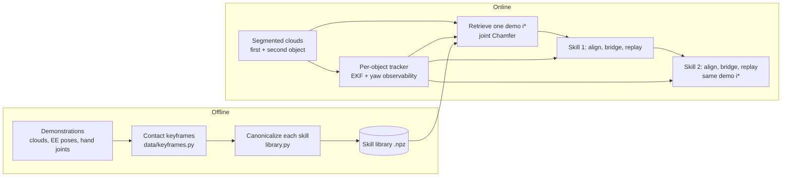

# Design rationale

This page explains why DexMulti is built the way it is: what each stage does, why it is
designed that way, which parameters control it, what it assumes, and what to change when
you port it to another robot, hand, sensor setup or task. For a paper-to-code map see
[method.md](method.md). For the data layout see [dataset.md](dataset.md). For the step-by-step
porting guide (robot and perception interfaces, all setup-specific values) see
[adapting.md](adapting.md). For what was run in the paper see [reproducing.md](reproducing.md).

Defaults quoted below come from [dexmulti/config.py](../dexmulti/config.py) unless another
file is named. Some parameters are hard-coded in the module that uses them. Those are listed
with their class and attribute name.

## 1. Problem and core idea

Each task has two stages on a tabletop: grasp a **first object**, then interact with a
**second object** while still holding the first one. The second object is a drawer (Grasp +
Pull), a container lid (Grasp + Open) or another object to grasp (Grasp + Grasp). In code
these are `object` and `drawer`. The data come from teleoperation with an xArm7 + LEAP Hand
and two RealSense L515 cameras: 38, 40 and 36 demonstrations for the three main tasks.

**DexMulti trains no policy.** Offline, each demonstration is cut into two **skills** at
contact keyframes. Each skill is stored in the **canonical frame** of the object it acts on
(centroid + yaw). Online, one demonstration is retrieved for the whole task by comparing
object shapes. For each skill, the robot then runs three phases: **alignment** (closed-loop
motion planning to the skill's first pose), a short **bridge**, and an open-loop
**replay** of the stored skill.

Why retrieve and replay instead of learning a policy:

- **Few demonstrations.** With about 40 demonstrations per task (3-4 per training
  object), a learned policy sees little coverage of placements and shapes. Retrieval only
  has to find a similar object; placement is handled by the canonical frame, not by data.
- **Contact-rich, long-horizon stages.** Holding with some fingers while others hook a
  handle or push a lid is hard to learn from few samples, and errors compound across
  stages. Replaying a recorded arm-and-hand trajectory reproduces a contact sequence that
  worked once.
- **Concurrent holding comes for free.** Skill 2 replays the demonstration's full hand
  trajectory, including the fingers that keep holding the first object. No separate grasp
  controller, force model or hand-object state is needed. This requires both skills to
  come from the **same** demonstration, which is why retrieval happens once per task (see
  [Retrieval](#24-retrieval)).
- **Free space is planned, contact is replayed.** Only the segments that start at contact
  are stored. The approach to each object, and the transport between objects, are
  replaced by the alignment planner, which needs collision avoidance and the current object
  pose, not demonstration fidelity. Before contact the object is fully visible and static,
  so this is where closed-loop correction is cheapest and most reliable.

The deployment loop is [dexmulti/runner.py](../dexmulti/runner.py) (`DexMultiRunner.run_once`).

## 2. Stages

### 2.1 Demonstrations and keyframes

**What it does.** [dexmulti/data/keyframes.py](../dexmulti/data/keyframes.py)
(`segment_episode`, CLI [scripts/segment_keyframes.py](../scripts/segment_keyframes.py))
finds four frames per episode: `task1_start`, `task1_end`, `task2_start`, `task2_end`.

- **Contact** at frame t: some object point has a soft contact score above
  `contact_thr = 0.8` ([perception/contact.py](../dexmulti/perception/contact.py),
  CordViP-style against a forward-kinematics hand cloud; about 4 cm normal-weighted
  distance), **and** the object centroid is within `clip(1.3 · r, 0.03, 0.15)` m of the
  nearest hand point (r: 90th-percentile object radius).
- **Start of skill k:** first frame of the **longest** contact run with object k; a leaky
  budget of `occl_frames = 10` bridges short dropouts.
- **End of skill 1:** the first object's centroid stays more than
  `clip(0.30 · height, 0.02, 0.035)` m above its `task1_start` height for 5 frames.
- **End of skill 2:** end of the episode, so it includes placing the object.

**Why.** A skill boundary should sit where free-space motion ends: before contact the
planner can take any collision-free path, after contact the exact motion matters and is
replayed. Contact comes from geometry the system already has (segmented clouds, FK hand
cloud), with no annotation or tactile sensor. The distance gate rejects false contact when
segmentation leaks onto the hand. The lift test ends skill 1 once the grasp holds, so
skill 2's alignment starts with the object in hand.

**Key parameters.** `KeyframeConfig` in `data/keyframes.py`: `contact_thr` (also
`--contact-thr` on the CLI), `occl_frames`, `dist_scale`, `dist_thr_min/max`,
`lift_frac`, `lift_dz_min/max`, `lift_frames`.

**Assumptions / when it breaks.**
- Exactly two skills in a fixed order (first object, then second object), and skill 1 ends
  in a lift.
- Contact with each object happens in one long run. If no contact with the second object is
  found, skill 2 starts right after skill 1.
- The ranges can overlap or be out of order: 3 Grasp + Grasp recordings (in two of them
  skill 2 starts before skill 1) and 5 sample-efficiency recordings; see
  `keyframe_overlaps.json` and [dataset.md](dataset.md#skill-labels). Such a skill-2 replay
  repeats part of skill 1, which breaks the fixed-order assumption above.
- The released keyframes are those used to build the libraries. The current script
  reproduces all start frames and 317/331 skill-1 ends ([reproducing.md](reproducing.md)).

**What to change.** Retune the thresholds for other object sizes, or replace the contact
signal with tactile or motor-current contact. You can also write `keyframes/<episode>.json`
by hand: [library.py](../dexmulti/library.py) only reads the four `task*_start/end` keys.
More than two stages need changes in `segment_episode`, `build_library`,
`retrieval.DualTaskPolicyChamfer` (two-object score, `retrieve_drawer`),
`alignment/world.build_world` (object and drawer slots) and `DexMultiRunner.run_once`, which
all assume two skills and two objects.

### 2.2 Canonical object frames

**What it does.** For each skill, [library.py](../dexmulti/library.py)
(`_canonicalize_skill`) takes the object cloud P at the skill's start frame. It computes the
centroid c and a yaw ψ, the direction of the first principal axis of the centered XY points
([geometry.py](../dexmulti/geometry.py) `estimate_yaw`). It then stores:

$$P^{canon} = R_z(-\psi)(P - c), \quad p^{canon}_t = R_z(-\psi)(p_t - c), \quad R^{canon}_t = R_z(-\psi) R_t$$

for every commanded EE pose (xArm `link7`) in the skill. Hand joint commands are stored
unchanged. At run time, a canonical pose is mapped back to the world with
$p = c + R_z(\psi) p^{canon}$ and $R = R_z(\psi) R^{canon}$ (`canon_action_to_world`).

**Why.** Objects resting on a table translate and rotate about the vertical axis but do not
tilt, so centroid + yaw covers the placement variation that matters, with no object model,
6D pose estimator or texture; it works on unseen instances. The paper's centroid-only
ablation shows that yaw matters for elongated objects and handles.

**Key parameters.** `build_library(pc_downsample=6000)` (`--pc-downsample`). The released
clouds have 512 points, so in practice this downsampling has no effect.

**Assumptions / when it breaks.**
- **z-up.** The base frame's z axis must be vertical; the code only rotates about z.
- **Sign ambiguity.** PCA yaw is defined only up to π (180°), and the library stores
  whatever sign the SVD returns: library yaws span the full circle. The run-time yaw is
  made consistent by the yaw-sign rule at alignment (see
  [Alignment](#25-alignment)), not here.
- **Near-round objects.** For near-round footprints, ψ is arbitrary. The tracker flags
  these as yaw-unobservable, and retrieval searches over yaw instead.
- **Partial occlusion.** The library cloud is taken at first contact (hand may occlude
  part of it); the query cloud before contact.
- **No scale normalization.** Size enters only through retrieval.

**What to change.** For objects with a distinguishable front, such as a mug handle or a
drawer front, a sign-consistent yaw would remove the π ambiguity. Change it consistently
in `geometry.estimate_yaw` (library), `tracker.pca_yaw_xy` (tracker) and
`geometry.resolve_yaw_sign_by_world_action` (alignment). For tilted supports, express clouds
in a gravity-aligned frame before canonicalizing.

### 2.3 State estimation

**What it does.** Each object has its own `ObjectFrameTracker`
([perception/tracker.py](../dexmulti/perception/tracker.py)), wrapped by
`ObjectStateEstimator` ([perception/state.py](../dexmulti/perception/state.py)), which also
fits collision spheres. Each tracker runs as follows:

- **EKF.** Constant-velocity EKF over $(x, y, z, \psi)$ and their rates. It measures the
  cloud centroid, and the PCA yaw with its sign flipped to lie within ±90° of the current
  estimate. Both updates are gated by NIS (normalized innovation squared) tests, and the
  yaw measurement noise grows when the cloud is nearly isotropic.
- **Yaw observability.** The instantaneous score is the product of three terms, each
  clipped to [0, 1]: anisotropy $(a - 1)/(a_{ref} - 1)$ with $a = \sigma_1/\sigma_2$ the
  ratio of XY singular values; size, the RMS extent along the principal axis divided by
  2.5 cm; and yaw confidence $\sigma_{ref} / \sigma_\psi$ with $\sigma_{ref} = 5°$. It is
  smoothed as $s \leftarrow 0.97 s + 0.03 \cdot \text{score}$ and thresholded with
  **hysteresis** (on above 0.7, off below 0.3). It starts at 0.5 (unobservable). With full
  evidence it takes about 18 updates (≈0.6 s at 30 Hz; the first update only initializes
  the filter, then 17 belief updates) to switch on. Without evidence it takes about 28-40
  updates (1-1.3 s) to switch off, depending on how saturated the belief is.
- **Task yaw.** The yaw handed to the rest of the system, `yaw_task`, follows the EKF yaw
  with gain β, where $\beta \leftarrow 0.8\beta + 0.2\beta^*$ and
  $\beta^* = \exp(-(\sigma_\psi/\sigma_{ref})^2)$ while observable, 0 otherwise. When yaw
  becomes unobservable, β decays to 0 and `yaw_task` is **held**. The position keeps
  tracking.
- **Ablation tracker.** `ObjectFrameTrackerBaseline` (paper Table II, "raw PCA"): raw
  centroid and PCA yaw per frame, always observable. `scripts/deploy.py --baseline-tracker`.

**Why.** Raw PCA yaw is noisy on short or round objects, jumps by π, and rotates under
hand occlusion; driving alignment with it would swing the target around a round apple.
Deciding observability explicitly, instead of trusting a pose estimator that always outputs
an orientation (the paper compares against FoundationPose), routes elongated objects and
drawers to the tracked yaw and round objects to yaw from shape matching at retrieval.
Hysteresis and the held task yaw stop a brief occlusion from rotating the target.

**Key parameters.** `TrackerConfig`: `rate_hz = 30.0`, `ekf_dt = 0.01` (kept as run, see
below), `num_spheres = 6`. `ObjectFrameTracker.__init__`: `obs_alpha = 0.03`,
`obs_on = 0.7`, `obs_off = 0.3`, `yaw_aniso_ref = 2.0`, `xy_extent_ref = 0.025` m,
`yaw_std_ref = 5°`. EKF noise and NIS gates are in `_EKFSE2Z.__init__`; the full list is in
[adapting.md](adapting.md#7-setup-specific-values).

**Assumptions / when it breaks.**
- One segmented cloud per object in the base frame; objects static or slowly moving.
- The EKF uses dt = 0.01 s although it runs at 30 Hz; the noise was tuned with this value.
- Hysteresis needs time on the static scene before retrieval. In
  [scripts/deploy.py](../scripts/deploy.py) the planner warmup and the move to the start
  pose provide it.
- The tracker's yaw sign is anchored by its initialization (yaw 0), not by the object.

**What to change.** Retune `yaw_aniso_ref` and `xy_extent_ref` for much smaller or larger
objects (thin objects look anisotropic but have noisy yaw); retune the EKF noise if you set
`ekf_dt` to the true period. Any estimator (e.g. a 6D tracker projected to centroid + yaw)
works if it produces an `ObjectState` ([interfaces.py](../dexmulti/interfaces.py)) whose
`yaw_observable` flag means "this yaw is safe to align to".

### 2.4 Retrieval

**What it does.** `DualTaskPolicyChamfer.retrieve_object`
([retrieval.py](../dexmulti/retrieval.py)) scores every library demonstration i jointly on
both objects and keeps the single best one:

$$i^* = \arg\min_i \; d_1(i) + \lambda \, d_2(i)$$

Here $d(P, Q)$ is the symmetric Chamfer distance: the mean nearest-neighbor distance from P
to Q plus the mean from Q to P. Each query cloud $\bar P$ is centered (centroid subtracted),
and each term is computed as follows:

- **Yaw observable:** $d = d(R_z(-\psi^{task}) \bar P, P^{canon}_i)$, one evaluation.
- **Yaw unobservable:** $d = \min_{\theta \in \Theta} d(R_z(\theta) \bar P, P^{canon}_i)$
  over 24 yaw bins (15° apart). The best θ* of the retrieved demonstration is stored, and
  alignment later uses $-\theta^*$ as the object's yaw.

Skill 2 reuses $i^*$. Right before skill 2, `retrieve_drawer` recomputes θ* for the second
object against that same demonstration, if its yaw is unobservable at that moment.

**Why.**
- **Shape similarity predicts whether a replayed grasp works.** With placement removed,
  Chamfer distance measures shape and size, with no correspondences, training or models.
- **Yaw search makes up for unobservable yaw.** The demonstrated grasp was performed at
  some angle; the θ under which shapes agree best doubles as a yaw estimate.
- **Retrieval is joint over both objects, and happens once.** Skill 2's hand trajectory
  assumes the grasp from the same demonstration's skill 1: which fingers hold the object
  and which are free to hook a handle or push a lid. Mixing skills from different
  demonstrations could leave the fingers needed in skill 2 occupied. Scoring both objects
  picks a demonstration that fits both stages. λ = 0.3 down-weights the second object
  (value as run; the paper writes an unweighted sum, see [reproducing.md](reproducing.md)).
  Our reading: the grasp is the most shape-sensitive step.

**Key parameters.** `RetrievalConfig.lambda_drawer = 0.3` (read by the runner);
`DualTaskPolicyChamfer(num_yaw_bins=24)` (default from `RetrievalConfig.num_yaw_bins`,
passed by `scripts/deploy.py`). `retrieve_object(exclude=i)` gives leave-one-out tests.

**Assumptions / when it breaks.**
- The library must contain a demonstration with a similar object. The nearest one is
  replayed unchanged, even if it is a poor match; there is no score threshold or fallback.
- With observable yaw, only one PCA sign is compared. For shapes that are not roughly
  symmetric under a 180° turn, the score may compare flipped clouds.
- Run time grows linearly with library size × yaw bins.
- **Kept-as-run quirk.** When the second object's yaw is observable, its centered query
  cloud is compared **without** rotating it by its yaw, unlike the first object. The term
  then also depends on the second object's world yaw. Its effect on the ranking has not been
  characterized; the behavior is kept for exact reproduction.

**What to change.** To fix the quirk, rotate `dr_pc_centered` by the second object's
tracked yaw (`runner.py` would need to pass it). Tune `lambda_drawer` and `num_yaw_bins`
for your objects; prefilter large libraries with a cheap global descriptor.

### 2.5 Alignment

**What it does.** `DexMultiRunner.align` runs at `ctrl_hz = 10` Hz for a fixed
`align_seconds = 10` s. Each step does the following:

1. **Target.** Map the skill's first canonical pose to the world with the live centroid and
   a yaw chosen in [targets.py](../dexmulti/alignment/targets.py): the tracker's `yaw_task`
   if yaw was observable at retrieval (held by the tracker while yaw is temporarily
   unobservable), otherwise $-\theta^*$ from retrieval.
2. **Sign rule.** Of $\psi$ and $\psi + \pi$, choose the one whose commanded world EE yaw is
   closest to 0 (hand facing forward), skipping candidates beyond
   `max_abs_world_yaw_rad = 120°`. If both are beyond it, the one with the smaller
   |world yaw| is used anyway (returned unwrapped, as run); no demonstration is rejected.
3. **Plan.** Solve a receding-horizon trajectory optimization over all 23 joints (7 arm +
   16 hand) with Pyroki/pyronot ([pyroki_planner.py](../dexmulti/alignment/pyroki_planner.py)):
   5 knots, dt = 0.1 s, at most 20 iterations, warm-started from the previous solution.
   Costs: EE pose at the last knot, smoothness, joint and velocity limits, rest pose,
   manipulability, self-collision, world collision and a hand-joint target. Only the next
   knot is sent, as a joint command.
4. **Collision world** ([world.py](../dexmulti/alignment/world.py)): a ground plane at
   `ground_z = 0.03` m, a wall at `wall_x = 0.68` m, and 6 spheres per object from the
   multi-sphere envelope ([perception/envelope.py](../dexmulti/perception/envelope.py):
   bins along the principal axis, medial centers, thickness-based radii, smoothed). In
   skill 1 the first object is an obstacle. In skill 2 it is held, so its spheres are
   replaced by placeholders (radius 1 cm at (1, 1, 1) m); it is not attached to the hand.
5. **Hand.** In skill 1 (a grasp), the hand target is the open hand (all zeros) for the
   first `grasp_open_fraction = 0.75` of the window, then the demonstration's first hand
   command. In skill 2, it is skill 2's first hand command throughout, so the hand keeps
   holding the first object.

The object pose of the last step, centroid plus the yaw that was used, is returned and then
**frozen** for the rest of the skill.

**Why.**
- **Joint space with collision costs.** The longest motions happen here: from the start
  pose to the first object, and from the lift to the second object with the first object in
  hand. A Cartesian interpolation could hit the drawer, the table or the wall, or pass near
  singularities. The receding-horizon planner re-reads the tracker every step and is cheap
  enough for 10 Hz.
- **Spheres instead of meshes.** A few spheres approximate partial, noisy clouds well
  enough for clearance, are fast to evaluate and stay stable under smoothing.
- **Fixed primitive count.** The planner is JIT-compiled for a fixed number and type of
  primitives, so the held object is swapped for placeholders instead of removed.
  [scripts/deploy.py](../scripts/deploy.py) calls `PyrokiAlignmentPlanner.warmup` before
  the trial so compilation does not eat into the 10 s window.
- **Open hand first** keeps the fingers from sweeping the object; switching to the first
  demonstrated hand command before the bridge pre-shapes the hand.
- **Forward-facing sign rule.** The demonstrations approach with the hand roughly facing
  forward, so keeping the commanded EE yaw near 0 resolves the PCA ambiguity without an
  object model.

**Key parameters.** The `DeployConfig` and `WorldConfig` values above, and
`PyrokiAlignmentPlanner(urdf_path, target_link_name="link7", len_traj=5, dt=0.1)` with
`PlannerWeights` preset `jan2026` (default) or `dec2025`; the Table I preset is unknown
([reproducing.md](reproducing.md)).

**Assumptions / when it breaks.**
- **No convergence check.** The 10 s window is fixed; the paper's "until converged" is not
  implemented.
- **Collision costs are soft.** The target touches the object that is also an obstacle,
  so the solver trades tracking against clearance; the rest of the gap is closed by the
  bridge, which checks no collisions. How large the gap is depends on the cost preset:
  in a kinematic check it was about 8 cm with `jan2026` and 2 cm with `dec2025`
  ([reproducing.md](reproducing.md#known-differences-and-choices)).
- **The held object is not modelled.** In skill 2 it is removed from the world and not
  attached to the hand, so only the robot is kept clear of the second object, table and
  wall; the clearance of the object in hand is not guaranteed.
- **No Cartesian limits here.** Alignment joint commands (and the unclamped
  `move_to_start` in `scripts/deploy.py`) are not workspace-clipped or step-limited. Safety
  relies on the planner's limit costs and the arm driver's joint speed limit
  (`XARM_JOINT_MAX_VELO = 0.35` rad/s in the ROS1 adapter).
- **Primitive count must stay fixed.** The envelope axis and bin edges are fixed on the first
  cloud (equal-count percentiles), so a sphere keeps radius 0 only if the first cloud has
  fewer than about 6 · 40 = 240 points. In practice the count changes when an object state
  is missing (`get_state` returns `None`, giving 0 spheres), which triggers a recompile.
- **Forward-facing assumption.** Side or backward approaches in the demonstrations would be
  flipped by π (if both hypotheses are beyond 120°, the smaller one is used).
- **Hard-coded robot.** `ARM_DOF = 7` and `HAND_DOF = 16` in the planner, the `q_cmd[:7]`
  split in the runner, and the all-zeros open hand are specific to xArm7 + LEAP Hand.

**What to change.** Provide a sphere-approximated URDF and `target_link_name`; adapt the
`WorldConfig` planes or add primitives in `static_world`. To protect the held object,
attach its spheres to the hand link in the robot collision model during skill 2. Add a
convergence test in `align` (EE pose error and tracker motion small). Revisit
`max_abs_world_yaw_rad` and the sign rule if your demonstrations approach from other
directions. See [adapting.md](adapting.md) ([planner](adapting.md#6-planner),
[setup-specific values](adapting.md#7-setup-specific-values)) for the full porting list.

### 2.6 Bridge and open-loop replay

**What it does.** `DexMultiRunner.run_skill` switches the arm to Cartesian pose control.
`run_bridge` ([execution.py](../dexmulti/execution.py)) then interpolates, over
`bridge_seconds = 3` s, from the current EE pose to the skill's first pose mapped with the
frozen object pose (position linearly, orientation with SLERP, hand joints linearly).
`run_replay` then streams every waypoint of the canonical skill through the same frozen pose
at 10 Hz: one waypoint per tick, the recording rate, so the skill plays at demonstration
speed. In the three task libraries, skill 1 averages 36-44 waypoints and skill 2 averages
47-117, depending on the task. Every Cartesian command, including the bridge's, is clipped
to the workspace box `x ∈ [0.1, 0.7]`, `y ∈ [-0.5, 0.5]`, `z ∈ [0.15, 0.5]` m and limited to
a step of 1 cm and 2.5° from the *measured* EE pose, i.e. 0.1 m/s and 25°/s at 10 Hz
(`clip_and_clamp`).

**Why.**
- **Bridge.** Alignment ends wherever the soft-cost solver stopped, in joint control.
  Jumping to the first replay waypoint in Cartesian control would cause a step. The bridge
  makes the hand-off smooth and lands on the demonstrated contact pose if the remaining gap
  fits within the rate limits (about 0.3 m or 75° in 3 s, less if the arm lags).
- **Open loop.** After contact the fingers occlude the cloud and the object is *supposed*
  to move (lift, slide, swing). Re-mapping through a live object frame would make the hand
  chase its own effect, e.g. shift a pull as the drawer opens. The demonstration encodes
  motion relative to the object's pose **before** interaction, i.e. the frozen pose; this is
  also why skill 2 can place the first object in the drawer's pre-opening frame.
- **Rate limits** bound the damage from a bad mapping.

**Key parameters.** `DeployConfig.bridge_seconds`, `ctrl_hz`; `ArmLimits.max_step_pos_m`,
`max_step_rot_deg` (per tick), `workspace`.

**Assumptions / when it breaks.**
- **Static scene.** Nothing may move except through the robot's own action. Recovery from
  perturbations (paper Fig. 5, top) comes only from closed-loop alignment, including the
  re-alignment to the second object at the start of skill 2; a perturbation during a replay
  is not corrected. The bridge and the replay check no collisions.
- **No catching up.** The clamp is relative to the measured pose and the replay does not
  wait; if the arm lags or the demonstration exceeded the limits, the robot cuts corners.
- Demonstrations must be recorded at `ctrl_hz`. The workspace box limits `link7`, not the
  fingertips.
- **Clipped replays.** The retrieved demonstration is moved with the new object pose, so
  an object that sits lower or further out than in the demonstration can push waypoints
  outside the workspace box. They are clipped, not rejected: in one of 12 recorded Grasp +
  Open scenes the replayed grasp was held at `z = 0.15` m for 74 steps, 2.3 cm above the
  mapped demonstration.

**What to change.** Resample demonstrations to your control rate, set `ArmLimits` to your
arm's safe speeds and workspace, and consider a contact- or force-based `early_stop_fn`.

## 3. Design limits

| Limit | Source | Possible extension |
|---|---|---|
| Static scene during replay | Open-loop replay with a frozen object pose (2.6) | Re-align on large tracker deviation; tactile or force checks |
| Rigid objects with a stable footprint | Canonical frame from one cloud at the skill start (2.2) | Per-part frames; shape-conditioned trajectory warping |
| Yaw-only canonicalization, z-up | Centroid + PCA yaw about base z, π-ambiguous (2.2, 2.3) | Gravity-aligned frame; 6D pose where observable; sign-consistent yaw |
| Single retrieved demonstration, no fallback | `argmin` over the library, no blending (2.4) | Top-k retrieval with feasibility checks; trajectory adaptation |
| Fixed two-skill order | Keyframes, library, retrieval and runner assume skill 1 then skill 2 (2.1) | Task graph over skills; re-retrieval after failure |
| Held object not in the collision model | Placeholders in skill 2, nothing attached to the hand (2.5) | Attach object spheres to the hand link |
| Per-robot demonstrations | Hand joints and `link7` poses are replayed as recorded (2.2, 2.6); the paper's Allegro results used separately collected demonstrations | Retarget hand trajectories; record per embodiment |
| Fixed-time alignment | `align_seconds = 10`, no convergence test (2.5) | Error-based termination |
| Calibrated multi-view segmentation | Clouds from Grounding DINO + SAM2 masks on two calibrated RGB-D cameras ([perception/denoise.py](../dexmulti/perception/denoise.py)) | Any stack that publishes clean per-object clouds in the base frame |
