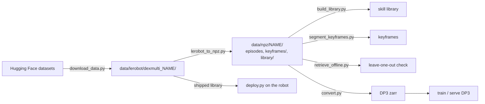

# Reproducing the paper

This page maps each experiment in the paper to the released data and settings. It explains
how to re-run each part, how this code was checked against the implementation that ran
the experiments, and where the two differ.

The release contains the code and the human demonstrations. It does not contain policy
checkpoints, the image-based DP and raw-point-cloud DP3 baselines,
or the FoundationPose and centroid-only ablations of Table II. Table III (Allegro Hand) is
not part of this release either.

## What was run

All experiments in Table I, Table II and Fig. 6 ran on the xArm7 + LEAP Hand with two RealSense
L515 cameras ([robots/xarm_leap_ros1](../robots/xarm_leap_ros1)). DexMulti used the defaults
in [dexmulti/config.py](../dexmulti/config.py).

| Result | Method | Skill library / training data | Settings |
|---|---|---|---|
| Table I | Ours | `dexmulti_grasp_{pull,open,grasp}/dexmulti/library/dual_task_policy_chamfer.npz` (38 / 40 / 36 demos) | defaults; planner preset not recorded (see [below](#known-differences-and-choices)) |
| Table I | Object-centric DP3 | the same 38 / 40 / 36 demos | [baselines/object_centric_dp3](../baselines/object_centric_dp3) |
| Table II | Ours | the Table I runs on training objects (same numbers as the Table I training-object cells) | as Table I |
| Table II | Raw PCA yaw | Table I libraries for Grasp + Pull and Grasp + Open | `scripts/deploy.py --baseline-tracker`, `jan2026` planner preset |
| Fig. 6 | Ours | `dexmulti_grasp_open_sample_efficiency/dexmulti/library/<set>.npz` | defaults, `jan2026` planner preset |
| Fig. 6 | Object-centric DP3 | episodes of `<set>` in `dexmulti/splits.json` | xyzc variant (point cloud + contact channel) |

Fig. 6 values and the dataset sets behind them (all Grasp + Open):

| Fig. 6 panel | value | set |
|---|---|---|
| quantity (one object, coconut) | 5 / 10 / 20 / 50 demos | `quantity_5` / `quantity_10` / `quantity_20` / `quantity_50` |
| diversity (44 demos) | 4 / 7 / 11 objects | `diversity_4obj_x11` / `diversity_7obj_x6+2` / `diversity_11obj_x4` |

The libraries of `quantity_10` and `quantity_20` were not saved when the experiments ran. The
released ones were rebuilt from those sets' own processed episodes ([dataset.md](dataset.md#sample-efficiency-sets)).

Protocol (Sec. V-A, V-B). "Training objects" are the objects in the demonstrations, and "test objects"
are held out (Fig. 4). Object placements were randomized within about ±25 cm. A trial
succeeds only if both subtasks are completed in sequence without intervention. Each Table I cell has
34 (Grasp + Pull, Grasp + Open, training objects), 31 (the same tasks, test objects), 27 (Grasp + Grasp,
training) or 15 (Grasp + Grasp, test) trials. Each Table II cell has 34.

The object-centric DP3 runs held out one episode per training set (`val_ratio=0.02`), so they
trained on N-1 demos. The [baseline README](../baselines/object_centric_dp3/README.md) lists every
variant that was trained; which of them produced the Table I numbers was not recorded.

## Re-running



### Setup

```bash
pip install -e ".[dev,perception,planner,lerobot]"     # Python >= 3.11 (the planner pins jax 0.8.1)
python scripts/download_data.py --dataset all            # -> data/lerobot/dexmulti_<name>/; --no-videos skips the camera videos
python scripts/lerobot_to_npz.py --dataset data/lerobot/dexmulti_grasp_pull --out data/npz/grasp_pull
python scripts/lerobot_to_npz.py --dataset data/lerobot/dexmulti_grasp_open_sample_efficiency \
    --split quantity_5 --out data/npz/quantity_5
```

`lerobot_to_npz.py` writes the episodes, the keyframes and the shipped library
(`library/dual_task_policy_chamfer.npz`) of a task or of one sample-efficiency set. The
dataset and the npz formats are described in [dataset.md](dataset.md).

### Offline (no robot)

**Tests.** `pytest` runs the unit tests and the regression tests against the original
implementation ([below](#equivalence-with-the-original-implementation)). The test data is in `tests/fixtures/`.

**Skill libraries.** Rebuild a library from the released episodes and keyframes, then compare it
with the shipped one:

```bash
python scripts/build_library.py --session data/npz/grasp_pull --out data/npz/grasp_pull/library/rebuilt.npz
python - <<'EOF'
import numpy as np
from dexmulti.library import load_library
a = load_library("data/npz/grasp_pull/library/dual_task_policy_chamfer.npz")
b = load_library("data/npz/grasp_pull/library/rebuilt.npz")
assert a.keys() == b.keys()
for k in a:
    assert len(a[k]) == len(b[k]) and all(np.array_equal(np.asarray(x), np.asarray(y)) for x, y in zip(a[k], b[k])), k
print("identical")
EOF
```

For a sample-efficiency set, convert with `--split <set>`. The converter substitutes the set's
own keyframes and keyframe clouds, so the rebuilt library equals `library/<set>.npz`.

**Keyframes.** `segment_keyframes.py` overwrites `<session>/keyframes/` when given `--overwrite`,
so run it on a copy:

```bash
cp -r data/npz/grasp_pull data/npz/grasp_pull_kf
python scripts/segment_keyframes.py --session data/npz/grasp_pull_kf --overwrite
python - <<'EOF'
import json
from pathlib import Path
ref, new = Path("data/npz/grasp_pull/keyframes"), Path("data/npz/grasp_pull_kf/keyframes")
for f in sorted(ref.glob("*.json")):
    a, b = json.loads(f.read_text()), json.loads((new / f.name).read_text())
    d = {k: (a[k], b[k]) for k in ("task1_start", "task1_end", "task2_start", "task2_end") if a[k] != b[k]}
    if d:
        print(f.stem, d)   # (released, re-detected)
EOF
```

On Grasp + Pull this prints `task1_end` differences for 3 of the 38 episodes and nothing else
([Keyframes](#known-differences-and-choices)).

**Leave-one-out retrieval.**

```bash
python scripts/retrieve_offline.py --session data/npz/grasp_pull         # add --viz to browse in viser
```

In our environment this prints a median grasp pose error of 5.5 cm / 28.8° over the 38
Grasp + Pull episodes. This is a sanity check of retrieval and the frame mapping, not a paper
result ([Offline retrieval](#known-differences-and-choices)).

**Object-centric DP3 training data.** `convert.py` imports the vendored iDP3 replay buffer, which
needs `zarr`; no dexmulti extra installs it. Run it in the baseline's environment
([requirements.txt](../baselines/object_centric_dp3/requirements.txt), see the
[baseline README](../baselines/object_centric_dp3/README.md)), from `baselines/object_centric_dp3/`:

```bash
python convert.py --variant xyzc --episodes-dir ../../data/npz/grasp_pull --out data/grasp_pull_xyzc.zarr
```

The resulting zarr arrays are identical to the paper's training data for the three tasks (xyz and xyzc) and for
`quantity_50`. For the other six sample-efficiency sets, the robot data is identical but the
`object_pc` / `drawer_pc` arrays differ slightly. Recordings shared between sets are stored once, as the
copy processed for another set, and only the library keyframe clouds are substituted per set
([dataset.md](dataset.md#sample-efficiency-sets)). The paper's DP3 used each set's own processing for every frame. Training and
serving are described in the [baseline README](../baselines/object_centric_dp3/README.md).

### On a robot

The shipped libraries can be used directly, without converting the dataset:

```bash
# Table I (Ours), one trial per call
python scripts/deploy.py --library data/lerobot/dexmulti_grasp_pull/dexmulti/library/dual_task_policy_chamfer.npz
# same, with the older planner cost preset
python scripts/deploy.py --library data/lerobot/dexmulti_grasp_pull/dexmulti/library/dual_task_policy_chamfer.npz \
    --planner-weights dec2025
# Table II, raw PCA yaw
python scripts/deploy.py --library data/lerobot/dexmulti_grasp_open/dexmulti/library/dual_task_policy_chamfer.npz --baseline-tracker
# Fig. 6 (Ours), e.g. 5 demos
python scripts/deploy.py --library data/lerobot/dexmulti_grasp_open_sample_efficiency/dexmulti/library/quantity_5.npz
```

`deploy.py` uses the ROS1 adapter for the paper's setup. It waits for both object states,
compiles the planner, moves to the start pose and runs one trial
([robots/xarm_leap_ros1/README.md](../robots/xarm_leap_ros1/README.md)). The released libraries store
xArm7 end-effector poses and LEAP Hand joint commands, so they do not transfer directly to
a different arm, hand or workspace. Record your own demonstrations, then build keyframes and a library from them.
See [adapting.md](adapting.md) and [design.md](design.md).

## Equivalence with the original implementation

This repository is a clean re-implementation of the code that ran the experiments, which
was part of a larger, robot-specific ROS1 codebase that is not released.
[tests/test_regression.py](../tests/test_regression.py) compares this code with outputs of the
original code on recorded data:

| Test | Checks |
|---|---|
| `test_retrieval_matches_original` | retrieved demo index, score (to 1e-9) and θ* |
| `test_tracker_matches_original` | EKF pose, yaw observability and collision spheres over a full recorded sequence; yaw to 1e-5 rad |
| `test_geometry_and_arm_limits_match_original` | canonical-to-world mapping, yaw-sign rule, workspace and step limits |

These were checked once against the original code before release and are not part of the test suite:

- **Libraries.** For the 8 training sets whose on-robot library was saved (3 tasks + 5
  sample-efficiency sets), rebuilding from the released episodes and keyframes gives exactly that
  library. The shipped files are those libraries re-saved without pickle. For `quantity_10` and
  `quantity_20` the shipped library is itself the rebuild (no on-robot copy exists), and rebuilding
  reproduces it exactly (`dexmulti/library/NOTES.json` in the dataset).
- **Planner.** Over a 15-step alignment, the in-process planner matches the original planner server
  to within 4e-6 rad.
- **DP3 converter.** On the paper's per-set processed episodes, `convert.py` reproduces bit-exactly the 13
  training sets the paper's DP3 models used (3 tasks in xyz and xyzc, 7 sample-efficiency sets in xyzc).
  For conversion from the released dataset, see [Offline](#offline-no-robot).
- **Keyframes.** On the data the libraries were built from, `segment_keyframes.py` reproduces every
  skill start frame and every skill-2 end frame of all 331 keyframe files (114 task episodes + 217
  sample-efficiency set entries), and the skill-1 end of 317 of them
  ([below](#known-differences-and-choices)). The 114 task episodes are the released ones. The 217
  sample-efficiency entries were checked on each set's own processed episodes, which are not
  released (see the Keyframes item below).

## Known differences and choices

- **Planner cost weights.** The planner on the robot computer was re-tuned during the
  project, and the change was never committed:

  | Preset | velocity limit | rest | collision margin | Provenance |
  |---|---|---|---|---|
  | `PlannerWeights.jan2026()` (default) | 10 | 0.01 | 0.1 | on the robot computer since 2026-01-04 |
  | `PlannerWeights.dec2025()` | 1 | 0.5 | 0.01 | committed on 2025-12-13 |

  The Table I results were collected from 2025-12-26 to 2025-12-30, and we could not determine
  which preset they used. The Table II ablation and Fig. 6 were run in late January 2026 with
  `jan2026`. Select with `scripts/deploy.py --planner-weights`
  ([dexmulti/alignment/pyroki_planner.py](../dexmulti/alignment/pyroki_planner.py)).

  The presets end alignment at different distances. We ran the runner closed loop against
  a kinematic robot (perfect tracking, static perception from 12 recorded scenes, 4 per
  task, leave-one-out retrieval). Alignment ended a median 7.9 cm (4.7-12.5) from the
  skill-1 target with `jan2026` and 2.0 cm (1.4-5.6) with `dec2025`; for skill 2 the numbers
  were 6.9 cm and 1.2 cm. The 10 cm collision margin of `jan2026` holds the hand back from
  the object and drawer spheres, which the target touches. The bridge closes the gap in
  both cases, but it does not check collisions, so with `jan2026` the last 5-10 cm of the
  approach is a straight line.
- **Keyframes.** The released keyframe files are the ones used to build the libraries.
  They were produced by earlier revisions of the segmentation script. The current
  [scripts/segment_keyframes.py](../scripts/segment_keyframes.py) matches the end of skill 1
  (the lift detection) on 317 of 331 episodes. The other 14 differ by between -23 and +7 frames.
  This count was measured on the data the libraries were built from, i.e. each sample-efficiency
  set's own processed episodes. The release stores each recording shared between sets once
  ([dataset.md](dataset.md#sample-efficiency-sets)), so re-detecting on a `--split <set>` conversion
  also gives start and end differences for a few sample-efficiency entries. Use the shipped
  (per-set) keyframes to reproduce a library.
- **Paper text vs. code.** Where the paper's description and the code that ran differ,
  this repository follows the code:
  - Alignment runs for a fixed 10 s (`DeployConfig.align_seconds`) and does not stop on
    convergence (Alg. 1, Sec. IV-D).
  - Arm commands are sent at 10 Hz. The interpolation factor of the arm interface was
    1 (10 Hz / 10 Hz), so the 20 Hz interpolation in Appendix C did not happen.
  - The per-camera random downsampling keeps at most 6000 points for the segmented object
    clouds. 8192 (Appendix A) is the setting for full-scene clouds
    ([dexmulti/perception/denoise.py](../dexmulti/perception/denoise.py)).
  - The joint retrieval score is $d_\text{first} + 0.3\, d_\text{second}$
    (`RetrievalConfig.lambda_drawer`), where Alg. 1 writes an unweighted sum.
  - A skill starts at the first frame of the *longest* run of sustained contact
    ([dexmulti/data/keyframes.py](../dexmulti/data/keyframes.py)), not necessarily the first run.
  - Object-centric DP3 (Appendix B): the paper runs used horizon 16 and 15 executed action steps
    (`horizon=16 n_action_steps=15`, 301 epochs), not a prediction horizon of 32 and an action
    chunk of 16 (300 epochs); see the [baseline README](../baselines/object_centric_dp3/README.md).
- **Kept as run.** These behaviours are preserved deliberately and commented in the code:
  - When the second object's yaw is observable, its query cloud is compared centered but
    not yaw-rotated ([dexmulti/retrieval.py](../dexmulti/retrieval.py)).
  - The tracker's EKF uses dt = 0.01 s while running at 30 Hz (`TrackerConfig.ekf_dt`).
    The EKF noise parameters were tuned with this value.
- **Planner runtime.** In the experiments the planner ran as a long-lived ZeroMQ server, compiled
  once. Here it runs in-process and is JIT-compiled before the trial by
  `PyrokiAlignmentPlanner.warmup` (about 18 s on CPU). Warmup must use a collision world with the same
  number of primitives as at run time. `build_world` swaps the held first object for placeholder
  spheres so the count does not change between skills. A sphere with zero radius or a missing object
  state still changes the count and triggers a recompile ([adapting.md](adapting.md#6-planner)).
- **Offline retrieval.** `scripts/retrieve_offline.py` approximates the robot's tracker
  (30 Hz updates, 3 s on the static scene before retrieval) on 10 Hz recordings, and it
  scores against the demonstrator's grasp, not task success. Its numbers are a sanity check, not a reproduction of a
  paper result.
